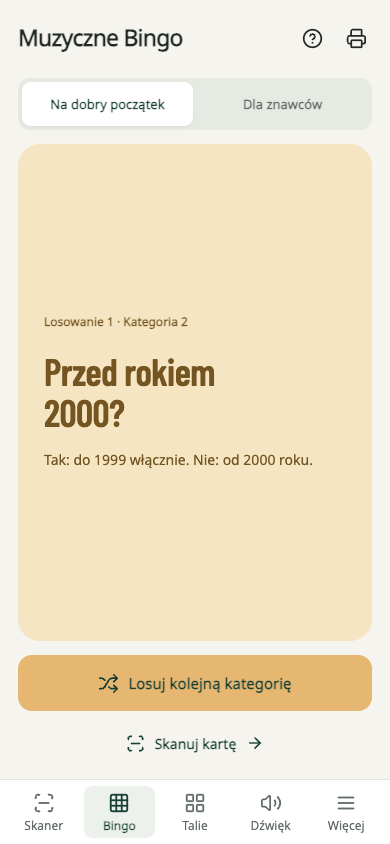

  

  Twórz własne karty muzyczne, skanuj je telefonem i zgaduj hity ze znajomymi.
   
  <strong>Od ulubionej playlisty do wspólnego wieczoru.</strong>

  
  
  

## Twój zestaw do muzycznej zabawy

Hiciarz zamienia ulubione nagrania w grę przy wspólnym stole. Przygotuj talię z muzyką, którą lubicie, wydrukuj karty i skanuj je telefonem. Posłuchajcie utworu, spróbujcie odgadnąć rok i ułożyć go na osi czasu — albo sprawdźcie, kto rozpozna muzykę z filmu lub gry.

**[Otwórz Hiciarza na GitHub Pages →](https://artifexet.github.io/Hiciarz/)** Działa w przeglądarce na telefonie i komputerze. Możesz też dodać go do ekranu początkowego jako PWA.

- **Wasza muzyka, Wasze talie.** Dodawaj utwory ręcznie, wczytuj pliki JSON/CSV lub importuj własne playlisty Spotify. Na początek czekają gotowe zestawy: świąteczne hity i muzyka z gier.
- **Karty w Waszym stylu.** Wybierz motyw, dodaj własny rewers i pobierz PDF do dwustronnego druku. Kwadratowe karty mają 60 × 60 mm.
- **Kilka sposobów na wspólną grę.** Muzyczna oś czasu, zgadywanie filmów i gier oraz Bingo z planszami do wydrukowania.
- **Muzyka tam, gdzie gracie.** Słuchaj na telefonie, steruj Spotify albo połącz skaner z odtwarzaczem na drugim ekranie.

## Zobacz Hiciarza

Przygotuj własną talię i od razu zobacz, jak będą wyglądać wydrukowane karty:

<table>
  <tr>
    <th>Skanuj i zgaduj</th>
    <th>Zagraj w muzyczne Bingo</th>
  </tr>
  <tr>
    <td width="50%" align="center"></td>
    <td width="50%" align="center"></td>
  </tr>
</table>

## Pierwsza rozgrywka

1. **[Otwórz Hiciarza](https://artifexet.github.io/Hiciarz/)** i wybierz **Twórz karty**. Zacznij od gotowej talii albo dodaj własne nagrania.
2. **Wybierz wygląd i wydrukuj karty.** Pobierz PDF, drukuj na A4 dwustronnie w skali 100%, a następnie wytnij karty. Przed całą talią warto wykonać próbę wydruku.
3. **Wybierz, gdzie ma grać muzyka.** W **Dźwięk** ustaw odtwarzanie na tym urządzeniu, Spotify Connect lub drugi ekran.
4. **Skanuj, słuchaj i zgaduj.** Zeskanuj QR z karty i sprawdź odpowiedź po jej odwróceniu. Jeśli masz już wydrukowaną talię, możesz od razu zacząć od **Skanuj karty**.

Wolisz Bingo? [Otwórz generator plansz PDF](https://artifexet.github.io/Hiciarz/?view=bingo&sheet=print&level=beginner&lang=pl), wydrukuj plansze i losuj kategorie muzycznych zagadek. Wybierz poziom podstawowy lub zaawansowany i liczbę potrzebnych wydruków.

## Spotify i inne sposoby słuchania

W przeglądarce możesz korzystać z osadzonych odtwarzaczy **Spotify i YouTube** bez konfigurowania połączenia Spotify w Hiciarzu. Spotify może udostępniać tylko fragment nagrania, a odtwarzacz może pokazywać tytuł i okładkę. Przy zgadywaniu przydaje się drugi ekran ustawiony poza wzrokiem graczy.

**Spotify Connect** pozwala sterować muzyką na wybranym urządzeniu Spotify i wymaga konta Premium. Import playlist oraz Connect wymagają połączenia konta z Hiciarzem; dostęp zależy od ustawień integracji Spotify. Gotowe talie i import plików JSON/CSV są dostępne bez logowania.

**[Jak połączyć Spotify i wybrać urządzenie →](web/docs/spotify.md)**

## Także na Androidzie

Wolisz natywną aplikację na telefonie? **[Pobierz testowy APK z GitHub Releases](https://github.com/ArtifexEt/Hiciarz/releases)**. Android skupia się na skanowaniu drukowanych kart i prowadzeniu Bingo. Prowadzący losuje pytanie, skanuje kartę i odtwarza jej utwór w Spotify. Aplikacja wymaga Androida 8.0 lub nowszego; talie, karty i plansze Bingo przygotujesz w przeglądarce.

[Instalacja i wymagania aplikacji Android](android-app/README.md#instalacja-wydania-testowego).

## Własne talie i pomoc

Talie zapisują się na używanym urządzeniu. Pobierz kopię JSON, aby zachować swój zestaw i przenieść go do PWA na innym urządzeniu. Android skanuje wydrukowane karty. Muzyka wymaga internetu; po zapisaniu zasobów PWA możesz bez sieci edytować talie i przygotowywać PDF.

- [Instrukcja korzystania z wersji przeglądarkowej](web/README.md)
- [Gotowe talie i pliki do pobrania](web/examples/playlists/README.md)
- [Format JSON/CSV i przygotowanie playlisty z pomocą AI](web/docs/playlist-guide.md)
- [Konfiguracja i rozwijanie projektu](web/docs/configuration.md) · [Dokumentacja Androida](android-app/README.md)

Masz pomysł lub coś nie działa? [Napisz w Issues](https://github.com/ArtifexEt/Hiciarz/issues/new/choose).

Jeśli Hiciarz uprzyjemnił Wam wieczór, możesz [postawić autorowi kawę](https://buymeacoffee.com/szymonrybka).
