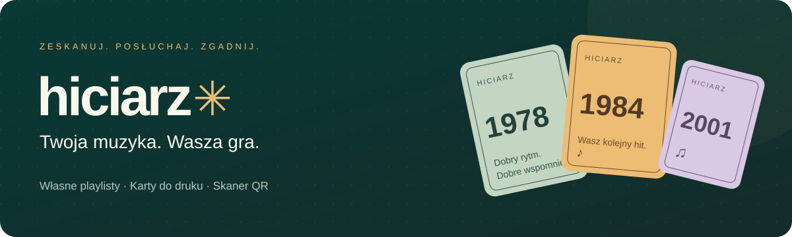

<p align="center">
  
</p>

<p align="center">
  Twórz własne karty muzyczne, skanuj je telefonem i zgaduj hity ze znajomymi.
  <br>
  <strong>Od ulubionej playlisty do wspólnego wieczoru.</strong>
</p>

<p align="center">
  <a href="https://artifexet.github.io/Hiciarz/"></a>
  <a href="#pierwsza-rozgrywka"></a>
  <a href="https://buymeacoffee.com/szymonrybka"></a>
</p>

<p align="center">
  <a href="https://github.com/ArtifexEt/Hiciarz/actions/workflows/pages.yml"></a>
  &nbsp; Przeglądarka · Telefon · Własne talie · PDF do druku
</p>

---

## Twój zestaw do muzycznej zabawy

Hiciarz łączy kreator kart, skaner QR i odtwarzacz w jednej aplikacji przeglądarkowej. Przygotuj swoją kolekcję piosenek, dobierz oprawę i wydrukuj talię. Podczas gry zeskanuj kartę, posłuchaj nagrania i spróbuj odgadnąć jego miejsce na muzycznej osi czasu.

| Przygotuj                                                                                  | Nadaj charakter                                              | Zagraj                                                                              |
| ------------------------------------------------------------------------------------------ | ------------------------------------------------------------ | ----------------------------------------------------------------------------------- |
| Dodawaj i edytuj piosenki, wczytuj JSON lub CSV, korzystaj z przykładów i importu Spotify. | Wybierz motyw, wgraj własny rewers i pobierz dwustronny PDF. | Skanuj QR telefonem i steruj Spotify albo połącz się z odtwarzaczem w przeglądarce. |

## Pierwsza rozgrywka

1. **[Otwórz Hiciarza](https://artifexet.github.io/Hiciarz/).** Na ekranie startowym wybierz **Skanuj i graj** albo **Twórz karty**.
2. **Wybierz piosenki.** Zacznij od **Przykładowych playlist** lub przygotuj własną listę. Tytuł, wykonawcę i rok możesz poprawić przed drukiem.
3. **Przygotuj karty.** Wybierz wygląd i pobierz PDF. Drukuj na A4 dwustronnie, w skali 100%. Najpierw wykonaj próbę kalibracyjną.
4. **Wybierz sposób słuchania.** Połącz Spotify albo uruchom odtwarzacz na drugim urządzeniu — oba warianty opisano poniżej.
5. **Skanuj i zgaduj.** QR z karty wskazuje nagranie i motyw. Jeśli aparat udostępnia zoom, przybliżysz obraz suwakiem lub przyciskami − / +.

## Muzyka tam, gdzie gracie

|                   | Spotify Connect                                                                   | Odtwarzacz w przeglądarce                                                                                               |
| ----------------- | --------------------------------------------------------------------------------- | ----------------------------------------------------------------------------------------------------------------------- |
| **Przygotowanie** | Wybierz **Skanuj i graj → Moje Spotify**, zaloguj się i wskaż aktywne urządzenie. | Na urządzeniu do odtwarzania otwórz **Odtwarzacz → Na tym urządzeniu → Połącz skaner**.                                 |
| **Skanowanie**    | Włącz aparat na telefonie i skanuj karty ze źródłem Spotify.                      | Telefonem zeskanuj QR parowania, a następnie kody z kart.                                                               |
| **Dźwięk**        | Muzyka gra na wybranym urządzeniu Spotify.                                        | Spotify lub YouTube odtwarza na połączonym urządzeniu; wyjście dźwięku wybierasz w systemie.                            |
| **Wymagania**     | Spotify Premium i urządzenie dostępne dla zalogowanego konta.                     | Nagranie dostępne do osadzenia. Spotify może odtwarzać tylko podgląd; przeglądarka może wymagać kliknięcia odtwarzania. |

## Świąteczny wieczór na start

W kreatorze czeka przykład **Świąteczne hity**: 151 piosenek z [polecanej playlisty Spotify](https://open.spotify.com/playlist/7wfTeAa7cxhA3qNE05XPKk), zapisanych 9 listopada 2026, z motywem **Rybki świąteczne**.

Wczytaj go **bez logowania**, jako nową talię lub dopisując utwory do obecnej. Własną kopię możesz dowolnie edytować. Lata pochodzą z wydań Spotify i są oznaczone do sprawdzenia przed drukiem.

**[Przeglądaj przykłady i dodaj własny →](examples/playlists/README.md)**

## Karty w Waszym stylu

- **Pięć motywów:** Klasyczny, Minimalistyczny, Świąteczna noc, Zimowa opowieść i autorskie Rybki świąteczne.
- **Spójna oprawa gry:** zeskanowana karta przełącza wygląd aplikacji na swój motyw.
- **Kolorowe awersy:** różne odcienie kart, ozdobne akcenty oraz czytelny rok, tytuł i wykonawca.
- **Własne rewersy:** wgraj grafikę lub wybierz gotowy preset.
- **Laser — lekki kolor:** białe tło, ciemny tekst i oszczędne kolorowe akcenty do drukarki laserowej.

PDF mieści 12 kart o wymiarach **60 × 60 mm** na stronie A4. Ustawienia druku obejmują krawędź obrotu, przesunięcia kalibracyjne i znaczniki cięcia.

## Playlisty i zapis

Import pyta, czy dopisać nowe utwory na końcu, czy zastąpić listę. Dopisywanie zachowuje ręczne poprawki i pomija duplikaty rozpoznane po źródle nagrania. Projekt zapiszesz jako JSON, a listę utworów również jako CSV.

> **Import Spotify:** obecna integracja odczytuje playlisty, których jesteś właścicielem lub współtwórcą. Spotify nie udostępnia jej zawartości pozostałych playlist, także publicznych. Gotowe przykłady można wczytać niezależnie od tego ograniczenia.

Talie i grafiki są zapisywane w Twojej przeglądarce. **Zapisz projekt do pliku**, aby mieć kopię lub przenieść talię na inne urządzenie. Aktualizacja aplikacji zachowuje lokalny zapis; w stopce znajdziesz wersję i przycisk **Sprawdź aktualizacje**.

## Rozwijaj Hiciarza

Wymagane: **Node.js 22+** i **pnpm 11**.

```sh
pnpm install
pnpm dev
```

Serwer poda lokalny adres z końcówką `/Hiciarz/`. Pozostałe polecenia:

```sh
pnpm test
pnpm build
```

| Dokumentacja                                          | Co znajdziesz                                                                            |
| ----------------------------------------------------- | ---------------------------------------------------------------------------------------- |
| [Konfiguracja i publikacja](docs/configuration.md)    | GitHub Pages, Spotify PKCE, zmienne Actions, parowanie, dane lokalne i zasoby graficzne. |
| [Przykładowe playlisty](examples/playlists/README.md) | Gotowe projekty oraz instrukcja dodawania kolejnych przykładów.                          |
| [Przygotowanie listy utworów](docs/playlist-guide.md) | Format JSON/CSV i sposób przygotowania playlisty z pomocą AI.                            |
| [Gotowy prompt](docs/playlist-prompt.txt)             | Treść do skopiowania przy tworzeniu własnej listy.                                       |

Konfiguracja Spotify korzysta z **Client ID dodawanego podczas budowania** i logowania PKCE. Client ID jest publiczny w gotowej aplikacji. **Client Secret nie jest używany i nie powinien trafiać do frontendu.**

---

## Podoba Ci się Hiciarz?

Jeśli aplikacja uprzyjemniła Wam wieczór, możesz [postawić autorowi kawę](https://buymeacoffee.com/szymonrybka). Dzięki za wsparcie kolejnych muzycznych spotkań.

Pomysły i zgłoszenia błędów zbieramy w [Issues](https://github.com/ArtifexEt/Hiciarz/issues).
