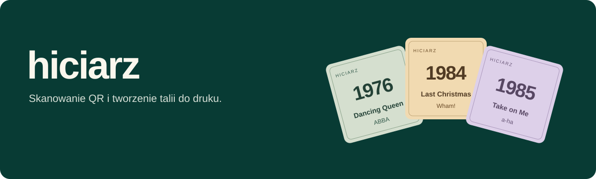
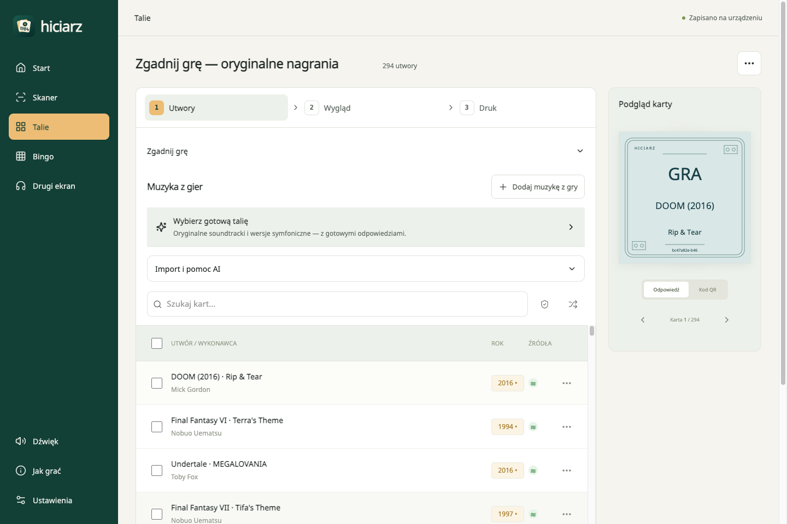

  

  Twórz własne karty muzyczne, skanuj je telefonem i słuchaj ulubionych nagrań.
   
  <strong>Od ulubionej playlisty do wspólnego wieczoru.</strong>

  
  
  

## Twoje karty z muzyką

Hiciarz łączy kreator kart, skaner QR i odtwarzacz. Przygotuj talię z ulubionymi nagraniami, wydrukuj karty i skanuj je telefonem, aby posłuchać muzyki. Na drugiej stronie znajdziesz dane utworu, a w taliach muzyki z filmów i gier także tytuł produkcji.

**[Otwórz Hiciarza na GitHub Pages →](https://artifexet.github.io/Hiciarz/)** Działa w przeglądarce na telefonie i komputerze. Możesz też dodać go do ekranu początkowego jako PWA.

- **Wasza muzyka, Wasze talie.** Wklejaj linki do utworów Spotify, sprawdzaj rok w MusicBrainz albo wczytuj pliki JSON/CSV. Na początek czekają gotowe zestawy: świąteczne hity i muzyka z gier.
- **Karty w Waszym stylu.** Wybierz motyw, dodaj własny rewers i pobierz PDF do dwustronnego druku. Kwadratowe karty mają 60 × 60 mm.
- **Różne rodzaje kart.** Utwory muzyczne, muzyka z filmów i muzyka z gier. [Bingo z planszami do druku](https://artifexet.github.io/Bingo/) działa w osobnej aplikacji.
- **Muzyka na wybranym urządzeniu.** Słuchaj na telefonie albo połącz skaner z odtwarzaczem na drugim ekranie.

## Zobacz Hiciarza

Przygotuj własną talię i od razu zobacz, jak będą wyglądać wydrukowane karty:

<table>
  <tr>
    <th>Skanuj i słuchaj</th>
    <th>Osobna aplikacja Bingo</th>
  </tr>
  <tr>
    <td width="50%" align="center"></td>
    <td width="50%" align="center"><a href="https://artifexet.github.io/Bingo/">Otwórz Bingo</a> Losowanie kategorii i plansze PDF do druku.</td>
  </tr>
</table>

## Pierwsze kroki

1. **[Otwórz Hiciarza](https://artifexet.github.io/Hiciarz/)** i wybierz **Twórz karty**. W **Talie → Utwory → Importuj** wybierz gotową talię, wczytaj plik albo przygotuj listę z AI. Możesz też dodawać nagrania ręcznie.
2. **Wybierz wygląd i wydrukuj karty.** Pobierz PDF, drukuj na A4 dwustronnie w skali 100%, a następnie wytnij karty. Przed całą talią warto wykonać próbę wydruku.
3. **Wybierz, gdzie ma grać muzyka.** W **Dźwięk** ustaw odtwarzanie na tym urządzeniu lub drugi ekran.
4. **Skanuj i słuchaj.** Zeskanuj QR z karty, aby uruchomić nagranie. Po drugiej stronie znajdziesz dane karty. Jeśli masz już wydrukowaną talię, możesz od razu zacząć od **Skanuj karty**.

Bingo ma osobną aplikację i [repozytorium](https://github.com/ArtifexEt/Bingo). [Otwórz generator plansz PDF](https://artifexet.github.io/Bingo/?sheet=print&level=beginner&lang=pl), wydrukuj plansze i losuj kategorie muzycznych zagadek. Wybierz poziom podstawowy lub zaawansowany i liczbę potrzebnych wydruków.

## Spotify i inne sposoby słuchania

W przeglądarce możesz korzystać z osadzonych odtwarzaczy **Spotify i YouTube** bez konfigurowania połączenia Spotify w Hiciarzu. Spotify może udostępniać tylko fragment nagrania, a odtwarzacz może pokazywać tytuł i okładkę. Drugi ekran pozwala oddzielić skanowanie kart od odtwarzania muzyki.

Hiciarz nie łączy konta Spotify. W kreatorze wklej link do konkretnego utworu, sprawdź podgląd i odsłuch, a następnie dobierz rok pierwszego wydania w MusicBrainz. Potwierdź dane przed dodaniem karty. Gotowe talie oraz import JSON/CSV również działają bez logowania.

**[Jak dodać utwór i korzystać z odsłuchu →](web/docs/spotify.md)**

## Także na Androidzie

Wolisz natywną aplikację na telefonie? **[Pobierz testowy APK z GitHub Releases](https://github.com/ArtifexEt/Hiciarz/releases)**. Android służy do skanowania drukowanych kart QR i uruchamiania ich utworów w Spotify. Aplikacja wymaga Androida 8.0 lub nowszego. Talie i karty przygotujesz w webowym Hiciarzu, a plansze do Bingo w [osobnej aplikacji](https://artifexet.github.io/Bingo/).

[Instalacja i wymagania aplikacji Android](android-app/README.md#instalacja-wydania-testowego).

## Własne talie i pomoc

Talie zapisują się na używanym urządzeniu. Pobierz kopię JSON, aby zachować swój zestaw i przenieść go do PWA na innym urządzeniu. Android skanuje wydrukowane karty. Muzyka wymaga internetu; po zapisaniu zasobów PWA możesz bez sieci edytować talie i przygotowywać PDF.

- [Instrukcja korzystania z wersji przeglądarkowej](web/README.md)
- [Gotowe talie i pliki do pobrania](web/examples/playlists/README.md)
- [Format JSON/CSV i przygotowanie playlisty z pomocą AI](web/docs/playlist-guide.md)
- [Konfiguracja i rozwijanie projektu](web/docs/configuration.md) · [Dokumentacja Androida](android-app/README.md)

Masz pomysł lub coś nie działa? [Napisz w Issues](https://github.com/ArtifexEt/Hiciarz/issues/new/choose).

Jeśli Hiciarz uprzyjemnił Wam wieczór, możesz [postawić autorowi kawę](https://buymeacoffee.com/szymonrybka).
