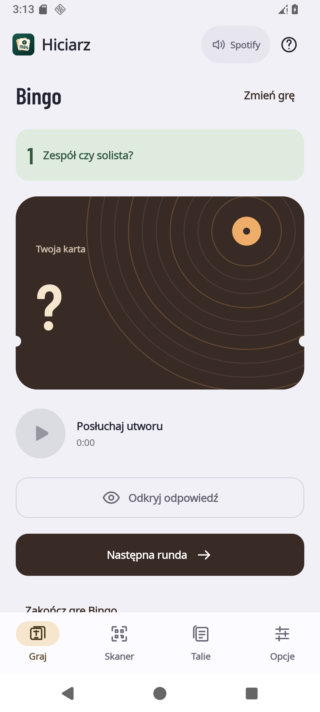
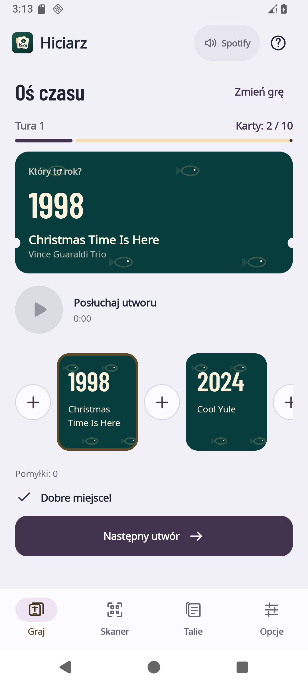
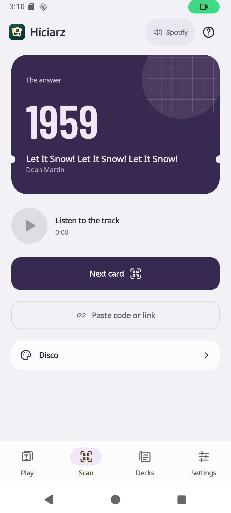
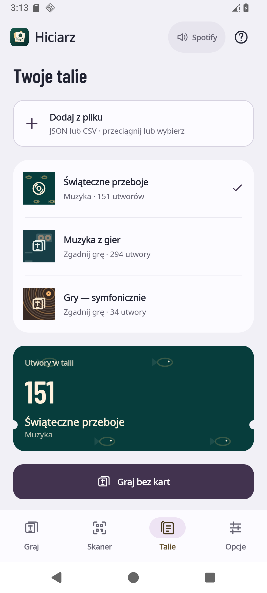
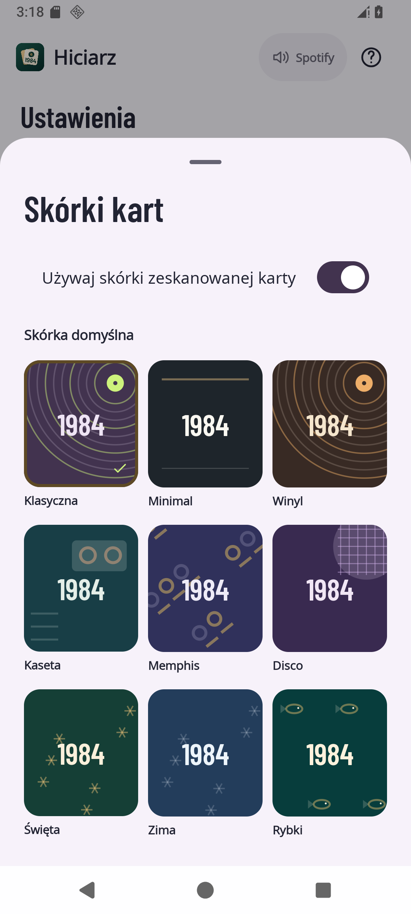
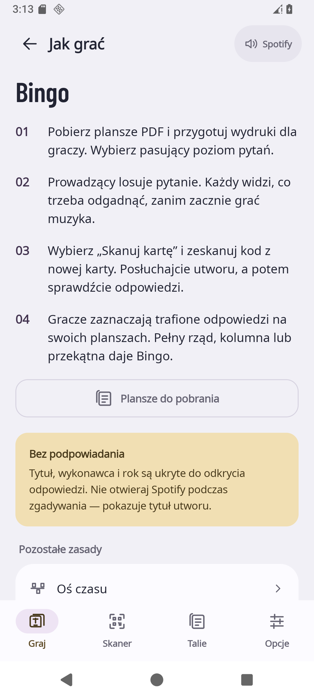

# Hiciarz na Androida

Natywna aplikacja Kotlin / Jetpack Compose do skanowania drukowanych kart, prowadzenia Bingo i grania bez kart w Oś czasu lub Zgadnij. Spotify odtwarza muzykę w swojej aplikacji, a Hiciarz steruje nim przez oficjalny App Remote SDK. Kreator kart i generator plansz PDF pozostają w [`../web/`](../web/).

W Bingo telefon prowadzącego najpierw losuje kategorię, a dopiero wybranie „Skanuj kartę” uruchamia aparat. Skan rozpoczyna utwór; gracze zaznaczają odpowiedzi na papierowych planszach. „Plansze do pobrania” otwiera generator z wybranym poziomem i językiem. Zasady każdej gry są dostępne pod „Jak grać”.

QR może automatycznie włączyć jedną z dziewięciu skórek. Ustawienia pozwalają wybrać własny wygląd i wyłączyć śledzenie skórki karty. Automatyczna pauza jest domyślnie wyłączona. Na dużym oknie i rozłożonym telefonie nawigacja przechodzi na bok, a niezależne panele uwzględniają zgięcie ekranu. [Porównanie funkcji z PWA](docs/pwa-parity.md) opisuje pełny zakres.

## Ekrany aplikacji

Zrzuty pochodzą z uruchomionej aplikacji na emulatorze AOSP. Karta z rokiem 1959 pokazuje rzeczywisty odczyt QR aparatem w zoptymalizowanym APK oraz automatyczne zastosowanie skórki Disco. W emulatorze Spotify nie jest zainstalowane.

| Bingo · telefon prowadzącego | Oś czasu · gra bez kart |
| --- | --- |
|  |  |

| Skaner · aparat | Odczytana karta · gotowy APK |
| --- | --- |
|  |  |

| Rozłożony ekran · dwa panele | Tabletop · poziome zgięcie |
| --- | --- |
|  |  |

Układy Folda sprawdzono w emulowanym oknie z pozycją zawiasu przekazywaną przez WindowManager. Nie jest to test na fizycznym Fold7.

<details>
<summary>Talie, skórki, pomoc i większy tekst</summary>

| Biblioteka talii | Dziewięć skórek |
| --- | --- |
|  |  |

| Jak grać w Bingo | Tryb ciemny · tekst 135% |
| --- | --- |
|  |  |

[Ekran przygotowania Bingo](docs/screenshots/phone-games-pl.png) · [Arkusz wyboru gry i talii](docs/screenshots/phone-game-options-pl.png)

</details>

## Instalacja wydania testowego

1. Pobierz `hiciarz-android-…-test.apk` z [GitHub Releases](https://github.com/ArtifexEt/Hiciarz/releases), z wydania oznaczonego **Pre-release**.
2. Otwórz plik na telefonie i zezwól użytej przeglądarce lub menedżerowi plików na instalację tego APK, jeśli Android o to poprosi.
3. W zainstalowanym Spotify zaloguj się na konto Premium. Otwórz Hiciarza, wybierz połączenie ze Spotify i zaakceptuj zgodę.

Wymagany jest Android 8.0 / API 26 lub nowszy. Aparat jest potrzebny do skanowania QR. Talię JSON lub CSV z kreatora można zaimportować z pliku.

Wydania z Releases są podpisane **prywatnym kluczem do testów**, przechowywanym w GitHub Secrets. Klucz i hasła nie trafiają do repozytorium ani do pobieranych artefaktów. Ten sam pakiet i podpis pozwalają instalować kolejne wersje bez usuwania aplikacji. Zmiana podpisu wymaga odinstalowania poprzedniej wersji i usuwa jej dane. Zachowaj pliki JSON / CSV importowanych talii, aby można je było wczytać ponownie.

## Spotify

Projekt używa App Remote, bez pośredniczącego serwera, Client Secret ani wywołań Web API do sterowania odtwarzaniem. Nadal potrzebuje publicznego **Client ID** i poprawnej konfiguracji aplikacji Android w [Spotify Developer Dashboard](https://developer.spotify.com/dashboard). Client ID nie jest hasłem i jest umieszczany w APK.

W ustawieniach integracji Spotify:

| Pole | Wartość |
| --- | --- |
| API / SDK | Android |
| Android package | `pl.artifex.hiciarz` |
| SHA-1 fingerprint | Odcisk certyfikatu podpisującego konkretny APK |
| Redirect URI | `hiciarz://spotify-callback` |

Odczytaj odcisk klucza używanego w lokalnym buildzie przez:

```sh
./gradlew :app:signingReport
```

Bez prywatnej konfiguracji podpisu lokalny build korzysta z klucza debug Androida. Dla wydania opublikowanego na GitHub właściwy odcisk znajduje się w `SIGNING-CERTIFICATE.txt`, odczytanym z gotowego APK. W Dashboard wpisz wartość **SHA-1**, a nie SHA-256. Po zmianie podpisu dodaj odcisk nowego klucza. Certyfikat i jego odciski są publiczne; nie zawierają prywatnego klucza. Osobny plik PEM nie jest potrzebny w repozytorium: Gradle używa magazynu kluczy przekazywanego w CI przez GitHub Secrets, a publiczny certyfikat jest częścią podpisanego APK.

Publiczna zmienna repozytorium `ANDROID_SIGNING_CERT_SHA256` określa oczekiwany odcisk oficjalnego podpisu. Workflow porównuje go z gotowym APK, aby przypadkowa wymiana klucza nie zerwała aktualizacji.

Publiczne odciski aktualnego certyfikatu wydań testowych:

```text
SHA-1:   45:02:B5:ED:CB:6C:94:06:2D:7D:82:55:D3:3D:9F:A9:15:D7:A1:86
SHA-256: 83:04:73:9D:8F:F1:E2:CF:D5:09:BF:08:BD:56:70:D7:0F:62:57:C3:52:E6:73:22:A9:84:BA:C6:81:38:D3:4C
```

Przy lokalnym buildzie ustaw publiczny identyfikator swojej integracji:

```sh
export SPOTIFY_CLIENT_ID='wstaw_swoj_32_znakowy_client_id'
./gradlew :app:assembleRelease
```

Alternatywnie Gradle obsługuje `-PspotifyClientId=…`. Zmienna środowiskowa ma pierwszeństwo. Aplikacja korzysta z identyfikatora dołączonego podczas budowania i nie pokazuje formularza konfiguracji Client ID. **Client Secret nie jest potrzebny i nie należy go dodawać do aplikacji ani repozytorium.**

Instrukcja konfiguracji odpowiada [oficjalnemu przewodnikowi App Remote dla Androida](https://developer.spotify.com/documentation/android/tutorials/getting-started).

### Development Mode i zakres testów

Spotify publikuje ograniczenia Development Mode i listy dozwolonych użytkowników dla [Web API](https://developer.spotify.com/documentation/web-api/concepts/quota-modes). Natywne App Remote korzysta z innej ścieżki połączenia, ale sam wybór APK **nie daje gwarancji dostępu dla dowolnego konta Spotify**.

Dotychczasowe próby potwierdziły sterowanie odtwarzaniem na testowanych kontach. Nadal brakuje próby na świeżym koncie i urządzeniu bez wcześniejszej zgody oraz bez historii dopisywania konta do integracji. Do czasu tej weryfikacji traktuj APK jako wydanie testowe. Błąd autoryzacji wymaga sprawdzenia konfiguracji Client ID, pakietu, podpisu i dostępu danego konta.

## Budowanie i testy

Wymagane są JDK 17 i Android SDK. Gradle Wrapper wybiera właściwą wersję Gradle. Nie trzeba instalować Gradle globalnie ani budować web przed Androidem.

Biblioteki są pobierane automatycznie przez Gradle. Spotify App Remote pochodzi z oficjalnego repozytorium Spotify, z przypiętym commitem i sprawdzaniem SHA-256; szczegóły opisano w [zależnościach Androida](docs/dependencies.md).

```sh
sdkmanager 'platforms;android-37.0' 'build-tools;37.0.0'
./gradlew :app:testDebugUnitTest :app:lintRelease :app:assembleRelease
```

Ustaw `ANDROID_HOME` na lokalizację Android SDK albo dodaj `sdk.dir=…` do lokalnego, ignorowanego pliku `local.properties`. JDK można wskazać przez `JAVA_HOME`.

| Wynik | Ścieżka w `android-app/` |
| --- | --- |
| Podpisany testowy APK | `app/build/outputs/apk/release/app-release.apk` |
| Raport testów JUnit | `app/build/reports/tests/testDebugUnitTest/index.html` |
| Raport lint | `app/build/reports/lint-results-release.html` |

Testy obejmują zgodność kart QR i importu JSON/CSV z kreatorem web, skórki, reguły Bingo, Osi czasu i quizu oraz zachowanie gry po odtworzeniu procesu. Nie potwierdzają autoryzacji Spotify na prawdziwym urządzeniu; tę część należy sprawdzić ręcznie.

CI uruchamia też natywne scenariusze Compose na emulatorze AOSP: losowanie pytania Bingo przed skanem, wklejenie kodu, odkrycie karty, Oś czasu, zmianę skórki i języka oraz zasady. Osobny scenariusz zmienia rzeczywiste okno Activity i publikuje pozycję pionowego oraz poziomego zgięcia przez WindowManager, sprawdzając, że panele nie nachodzą na zawias. Obejmuje ekran telefonu 360 dp, zewnętrzny i wewnętrzny ekran Folda, krótki widok poziomy, tryb ciemny i powiększenie tekstu. Zrzuty PNG trafiają do artefaktu `android-native-ui-…` obok raportu testów. Jest to test emulatora, a nie deklaracja sprawdzenia na fizycznym Fold7.

Testy regresji sprawdzają globalne wznawianie Spotify po zmianie zakładki, odtwarzanie wybranej karty oraz zachowanie rundy Bingo przy ponownym wyborze tej samej talii. Działają na emulatorze bez konta Spotify.

Przykładowe talie są kopiowane z `../web/examples/playlists/` podczas `preBuild`. Opcjonalna zmienna `HICIARZ_BUILD_ROOT` przenosi katalogi wynikowe Gradle na inny dysk; podane wyżej ścieżki dotyczą standardowego buildu bez tej zmiennej.

### Podpis i wersja

Prywatnego pliku JKS / keystore i haseł nie umieszczaj w repozytorium, dokumentacji ani zgłoszeniach. Lokalny build bez konfiguracji korzysta ze standardowego klucza debug. Taki APK służy do lokalnych testów; jego podpis różni się od podpisu oficjalnych wydań i może wymagać osobnej rejestracji w Spotify Dashboard.

Własny magazyn podpisu, przechowywany poza śledzonymi plikami, można wskazać zmiennymi środowiskowymi:

| Zmienna | Znaczenie |
| --- | --- |
| `HICIARZ_KEYSTORE_FILE` | Ścieżka do własnego pliku JKS / keystore, najlepiej absolutna |
| `HICIARZ_KEYSTORE_PASSWORD` | Hasło magazynu |
| `HICIARZ_KEY_ALIAS` | Alias klucza |
| `HICIARZ_KEY_PASSWORD` | Hasło klucza |
| `HICIARZ_PRODUCTION_SIGNING` | `false` dla prywatnego podpisu testowego; `true` dopiero dla docelowego podpisu produkcyjnego |

Hasła własnego klucza przekazuj lokalnie lub przez sekrety systemu budowania. Oficjalny workflow korzysta z prywatnego podpisu testowego i nie oznacza APK jako wydania produkcyjnego.

W **Settings → Secrets and variables → Actions → Secrets** ustaw:

| GitHub Secret | Zawartość |
| --- | --- |
| `HICIARZ_KEYSTORE_BASE64` | Prywatny magazyn podpisu zakodowany Base64 |
| `HICIARZ_KEYSTORE_PASSWORD` | Hasło magazynu |
| `HICIARZ_KEY_ALIAS` | Alias klucza |
| `HICIARZ_KEY_PASSWORD` | Hasło klucza |

Publiczne `SPOTIFY_CLIENT_ID` i `ANDROID_SIGNING_CERT_SHA256` umieść osobno w **Variables**. Odcisk może mieć postać 64 znaków szesnastkowych albo zapisu z dwukropkami. Workflow odtwarza magazyn wyłącznie w tymczasowym katalogu runnera, usuwa go po zakończeniu i publikuje tylko APK, sumę kontrolną oraz publiczne metadane podpisu.

```sh
./gradlew :app:assembleRelease -PversionName=0.1.0-alpha.2 -PversionCode=100002
```

Do aktualizacji zainstalowanego APK użyj tego samego podpisu i większego `versionCode`. Numer lokalnego buildu powinien być większy od numeru już zainstalowanego wydania, podanego w `BUILD-INFO.txt`.

## Wydania z GitHub Actions

Workflow [`android-release.yml`](../.github/workflows/android-release.yml) uruchamia tag `android-v<wersja>` albo ręczne **Run workflow**. Publiczny identyfikator Spotify pochodzi ze zmiennej repozytorium `SPOTIFY_CLIENT_ID`, z obsługą istniejącego sekretu Actions jako wartości zapasowej.

Publikacja wymaga kompletu czterech sekretów podpisu oraz publicznego odcisku certyfikatu. Przed publikacją workflow uruchamia testy i lint, buduje APK, sprawdza zgodność podpisu z `ANDROID_SIGNING_CERT_SHA256` oraz porównuje faktyczny pakiet, `versionName` i `versionCode` z żądaną wersją. Powstaje wydanie **Pre-release** zawierające:

- `hiciarz-android-<wersja>-test.apk`;
- plik `.apk.sha256` z sumą kontrolną APK;
- `SIGNING-CERTIFICATE.txt` z publicznymi odciskami certyfikatu;
- `BUILD-INFO.txt` z numerami wersji i commitem źródeł.

Istniejące wydanie nie jest nadpisywane, a tag wskazujący inny commit przerywa publikację. Poprawka wymaga nowej wersji. Domyślny `versionCode` to `100000 + numer uruchomienia workflow`; ręcznie podany numer musi zachować rosnącą kolejność wydań.

Zwykłe CI może działać bez sekretów, np. w forku: wtedy używa efemerycznego klucza debug i sprawdza, czy APK jest podpisane. Takie artefakty nie są oficjalnym wydaniem. Workflow Releases nie korzysta z tego fallbacku i przerwie publikację przy braku prywatnego podpisu.

Po pobraniu APK i pliku sumy do tego samego katalogu sprawdź integralność na Linuksie:

```sh
sha256sum --check hiciarz-android-0.1.0-alpha.1-test.apk.sha256
```

Na macOS odpowiednikiem jest `shasum -a 256 --check …`. Odcisk podpisu można dodatkowo odczytać narzędziem Android SDK `apksigner verify --print-certs <plik.apk>` i porównać z `SIGNING-CERTIFICATE.txt`.

Publikacja APK i commity dotyczące wyłącznie Androida nie uruchamiają GitHub Pages. Zmiany web na `main` wdraża automatycznie osobny workflow **Publish website**, dostępny także ręcznie. Dotychczasowe funkcje web i PWA pozostają dostępne.
