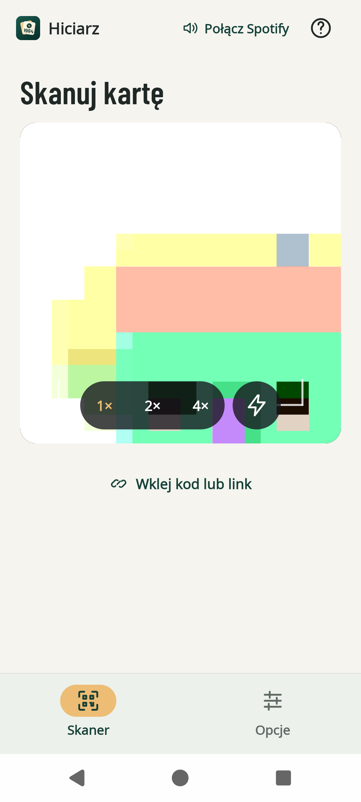
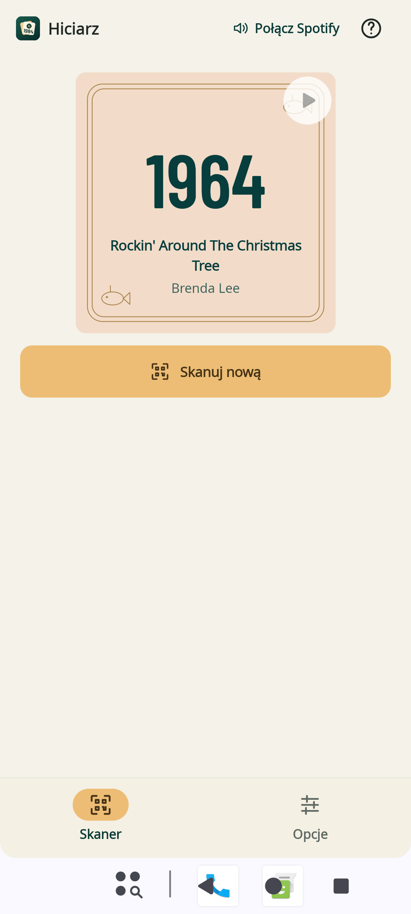
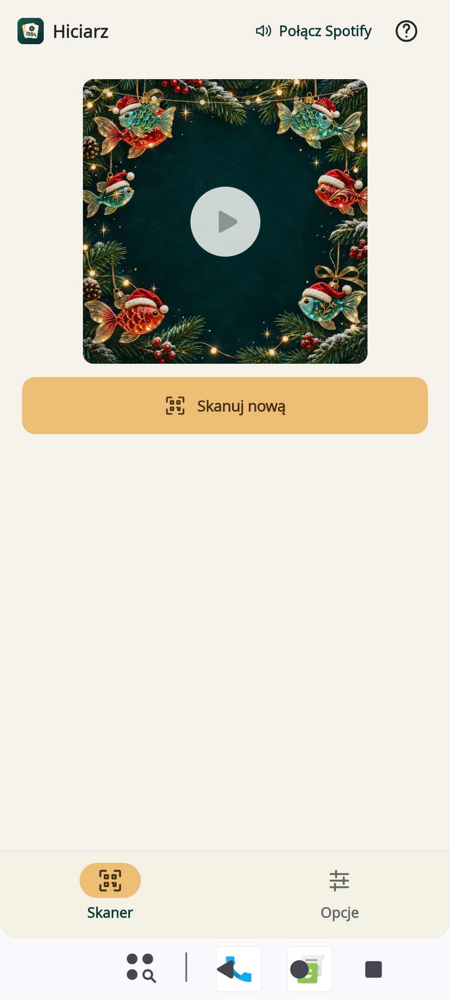
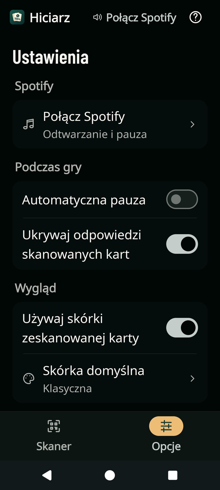
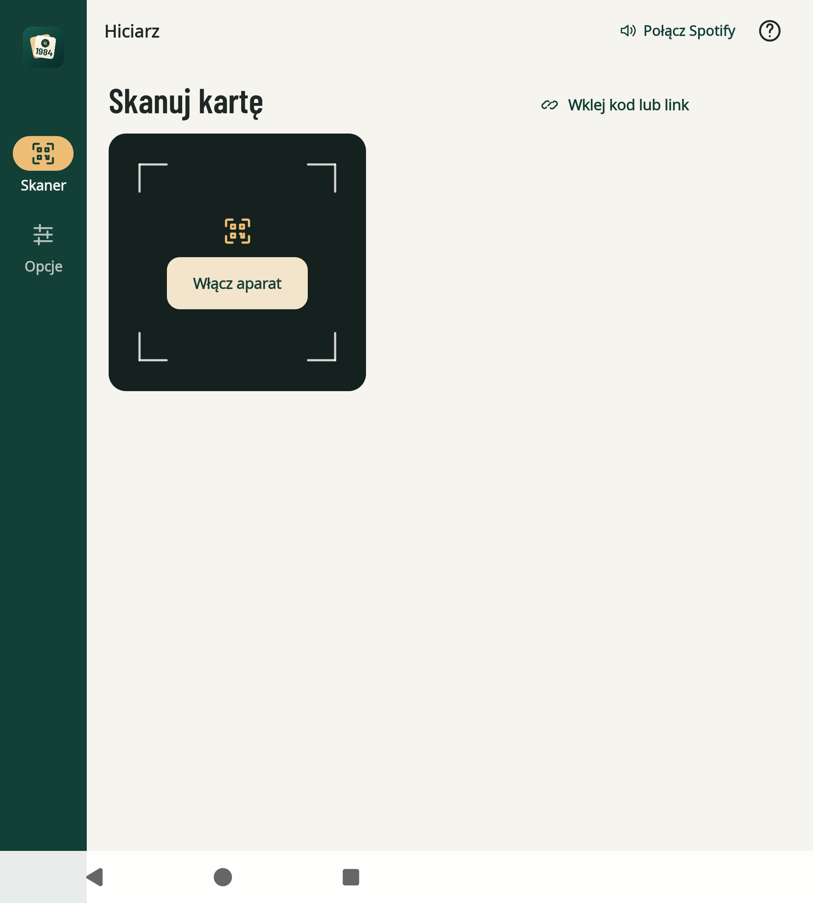
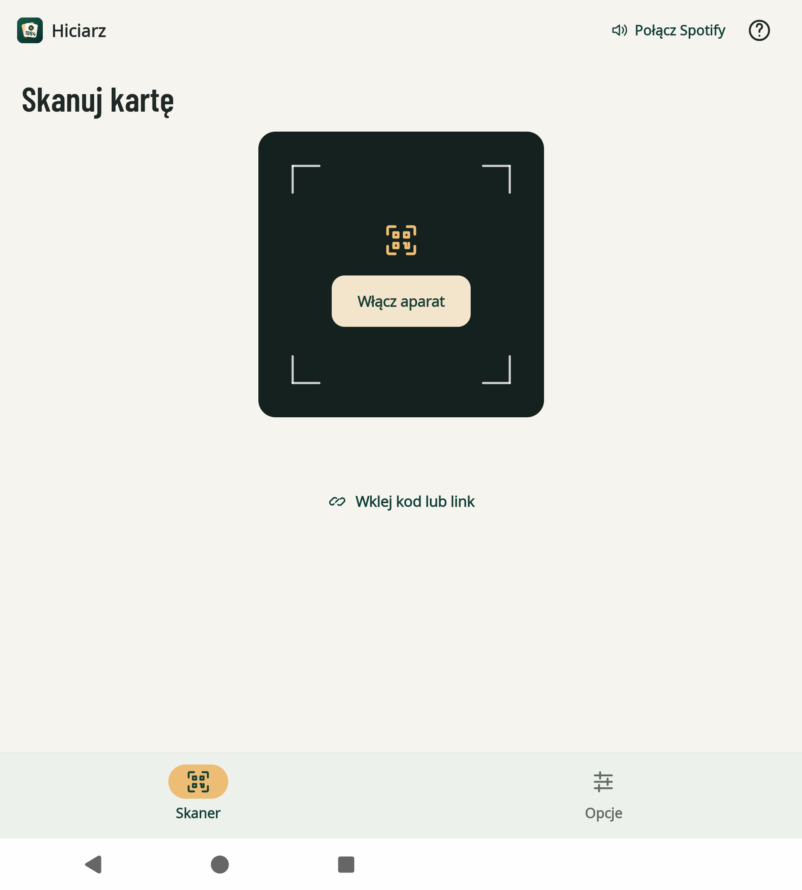
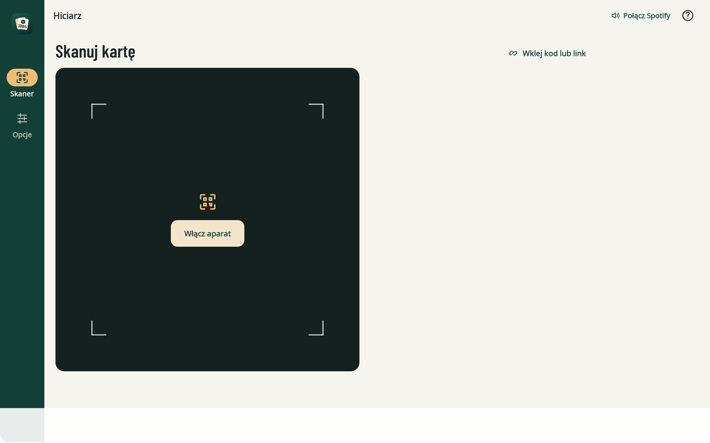
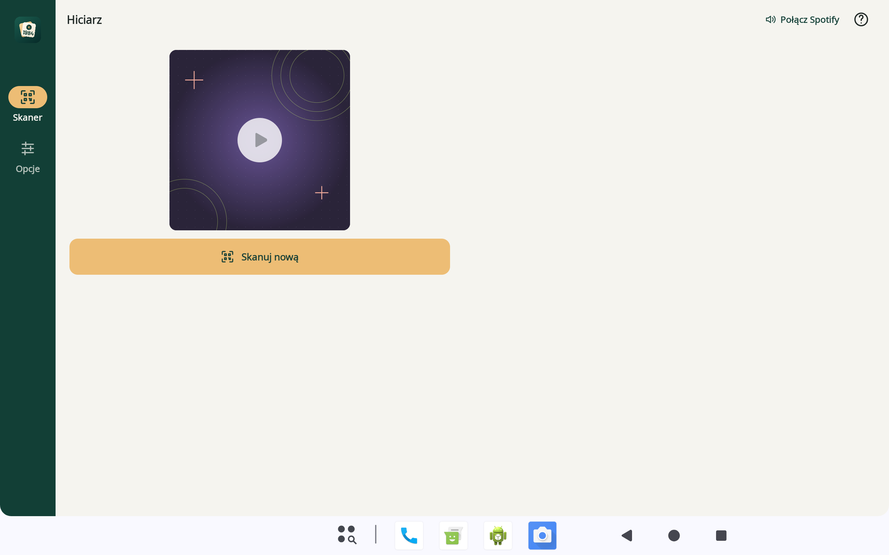

# Hiciarz na Androida

Plan publikacji w sklepie: [proces wydania w Google Play](docs/google-play-release.md).

Natywna aplikacja Kotlin / Jetpack Compose do skanowania drukowanych kart QR i uruchamiania przypisanej muzyki. Otwiera się na skanerze, a nawigacja zawiera **Skaner i Opcje**. Spotify odtwarza muzykę w swojej aplikacji, a Hiciarz steruje nim przez oficjalny App Remote SDK. Biblioteka talii, kreator kart i generator PDF są dostępne w [`../web/`](../web/). [Bingo i plansze do druku](https://artifexet.github.io/Bingo/) mają osobne [repozytorium](https://github.com/ArtifexEt/Bingo).

Skaner i karta zachowują kwadratowe proporcje również na tablecie. Pauza i wznowienie znajdują się na obrazie karty, a pod nią jest przycisk „Skanuj nową”. Odtwarzanie i skórka działają na podstawie QR także dla utworów, których danych aplikacja nie zna. Odkrywanie jest dostępne, gdy zapisane dane pozwalają wyświetlić odpowiedź; dla pozostałych kart odpowiedź pozostaje na wydruku.

Kod QR może automatycznie włączyć jedną z dziewięciu skórek. Palety i grafiki odpowiadają wersji web i uwzględniają tryb ciemny; rybki mają animowane ozdoby i lampki. W Opcjach można wybrać własny wygląd i wyłączyć śledzenie skórki karty. Automatyczna pauza jest domyślnie wyłączona. Na dużym oknie nawigacja przechodzi na bok, a panele uwzględniają zgięcie ekranu. [Podział funkcji PWA i Androida](docs/pwa-parity.md) opisuje pełny zakres.

Po aktualizacji ze starszej wersji aplikacja uruchamia skaner i pomija zapisane rundy usuniętych trybów. Zachowuje ustawienia, dane talii i skanowanych kart.

Zegar i systemowy pasek statusu są ukryte również w panelach opcji i dialogach. Dolna nawigacja systemowa pozostaje dostępna. Android pozwala rozwinąć powiadomienia gestem od góry i może chwilowo odsłonić pasek podczas animacji wskaźnika aparatu.

## Ekrany aplikacji

Zrzuty pochodzą z aplikacji na emulatorze AOSP bez zainstalowanego Spotify. Układy Folda korzystają z emulowanego okna i pozycji zawiasu przekazywanej przez WindowManager.

| Skaner | Odkryta karta |
| --- | --- |
|  |  |

| Rybki | Opcje i większy tekst |
| --- | --- |
|  |  |

| Rozłożony ekran | Poziome zgięcie |
| --- | --- |
|  |  |

| Tablet i aparat | Tablet i karta |
| --- | --- |
|  |  |

[Dziewięć skórek aplikacji](docs/screenshots/phone-skins-pl.png).

## Instalacja wydania testowego

1. Pobierz `hiciarz-android-…-test.apk` z [GitHub Releases](https://github.com/ArtifexEt/Hiciarz/releases), z wydania oznaczonego **Pre-release**.
2. Otwórz plik na telefonie i zezwól użytej przeglądarce lub menedżerowi plików na instalację tego APK, jeśli Android o to poprosi.
3. W zainstalowanym Spotify zaloguj się na konto Premium. Otwórz Hiciarza, wybierz połączenie ze Spotify i zaakceptuj zgodę.

Wymagany jest Android 8.0 / API 26 lub nowszy. Aparat jest potrzebny do skanowania QR. Przygotowanie i import talii JSON/CSV odbywają się w PWA. Wcześniej zapisane talie pozostają na urządzeniu i mogą uzupełniać informacje o zeskanowanej karcie.

Wydania z Releases są podpisane **prywatnym kluczem do testów**, przechowywanym w GitHub Secrets. Klucz i hasła nie trafiają do repozytorium ani do pobieranych artefaktów. Ten sam pakiet i podpis pozwalają instalować kolejne wersje bez usuwania aplikacji. Zmiana podpisu wymaga odinstalowania poprzedniej wersji i usuwa jej dane. Zachowaj pliki JSON / CSV importowanych talii, aby można je było wczytać ponownie.

## Spotify

Projekt używa App Remote, bez pośredniczącego serwera, Client Secret ani wywołań Web API do sterowania odtwarzaniem. Nadal potrzebuje publicznego **Client ID** i poprawnej konfiguracji aplikacji Android w [Spotify Developer Dashboard](https://developer.spotify.com/dashboard). Client ID nie jest hasłem i jest umieszczany w APK.

W ustawieniach integracji Spotify:

| Pole | Wartość |
| --- | --- |
| API / SDK | Android |
| Android package | `pl.artifex.hiciarz` |
| SHA-1 fingerprint | Odcisk certyfikatu podpisującego konkretny APK |
| Redirect URI | `hiciarz://spotify-callback` |

Odczytaj odcisk klucza używanego w lokalnym buildzie przez:

```sh
./gradlew :app:signingReport
```

Bez prywatnej konfiguracji podpisu lokalny build korzysta z klucza debug Androida. Dla wydania opublikowanego na GitHub właściwy odcisk znajduje się w `SIGNING-CERTIFICATE.txt`, odczytanym z gotowego APK. W Dashboard wpisz wartość **SHA-1**, a nie SHA-256. Po zmianie podpisu dodaj odcisk nowego klucza. Certyfikat i jego odciski są publiczne; nie zawierają prywatnego klucza. Osobny plik PEM nie jest potrzebny w repozytorium: Gradle używa magazynu kluczy przekazywanego w CI przez GitHub Secrets, a publiczny certyfikat jest częścią podpisanego APK.

Publiczna zmienna repozytorium `ANDROID_SIGNING_CERT_SHA256` określa oczekiwany odcisk oficjalnego podpisu. Workflow porównuje go z gotowym APK, aby przypadkowa wymiana klucza nie zerwała aktualizacji.

Publiczne odciski aktualnego certyfikatu wydań testowych:

```text
SHA-1:   45:02:B5:ED:CB:6C:94:06:2D:7D:82:55:D3:3D:9F:A9:15:D7:A1:86
SHA-256: 83:04:73:9D:8F:F1:E2:CF:D5:09:BF:08:BD:56:70:D7:0F:62:57:C3:52:E6:73:22:A9:84:BA:C6:81:38:D3:4C
```

Przy lokalnym buildzie ustaw publiczny identyfikator swojej integracji:

```sh
export SPOTIFY_CLIENT_ID='wstaw_swoj_32_znakowy_client_id'
./gradlew :app:assembleRelease
```

Alternatywnie Gradle obsługuje `-PspotifyClientId=…`. Zmienna środowiskowa ma pierwszeństwo. Aplikacja korzysta z identyfikatora dołączonego podczas budowania i nie pokazuje formularza konfiguracji Client ID. **Client Secret nie jest potrzebny i nie należy go dodawać do aplikacji ani repozytorium.**

Instrukcja konfiguracji odpowiada [oficjalnemu przewodnikowi App Remote dla Androida](https://developer.spotify.com/documentation/android/tutorials/getting-started).

### Development Mode i zakres testów

Spotify publikuje ograniczenia Development Mode i listy dozwolonych użytkowników dla [Web API](https://developer.spotify.com/documentation/web-api/concepts/quota-modes). Natywne App Remote korzysta z innej ścieżki połączenia, ale sam wybór APK **nie daje gwarancji dostępu dla dowolnego konta Spotify**.

Dotychczasowe próby potwierdziły sterowanie odtwarzaniem na testowanych kontach. Nadal brakuje próby na świeżym koncie i urządzeniu bez wcześniejszej zgody oraz bez historii dopisywania konta do integracji. Do czasu tej weryfikacji traktuj APK jako wydanie testowe. Błąd autoryzacji wymaga sprawdzenia konfiguracji Client ID, pakietu, podpisu i dostępu danego konta.

## Budowanie i testy

Wymagane są JDK 17 i Android SDK. Gradle Wrapper wybiera właściwą wersję Gradle. Nie trzeba instalować Gradle globalnie ani budować web przed Androidem.

Biblioteki są pobierane automatycznie przez Gradle. Spotify App Remote pochodzi z oficjalnego repozytorium Spotify, z przypiętym commitem i sprawdzaniem SHA-256; szczegóły opisano w [zależnościach Androida](docs/dependencies.md).

```sh
sdkmanager 'platforms;android-37.0' 'build-tools;37.0.0'
./gradlew :app:testDebugUnitTest :app:lintRelease :app:assembleRelease
```

Ustaw `ANDROID_HOME` na lokalizację Android SDK albo dodaj `sdk.dir=…` do lokalnego, ignorowanego pliku `local.properties`. JDK można wskazać przez `JAVA_HOME`.

| Wynik | Ścieżka w `android-app/` |
| --- | --- |
| Podpisany testowy APK | `app/build/outputs/apk/release/app-release.apk` |
| Raport testów JUnit | `app/build/reports/tests/testDebugUnitTest/index.html` |
| Raport lint | `app/build/reports/lint-results-release.html` |

Testy obejmują zgodność kart QR i importu JSON/CSV z kreatorem web, skórki, zachowanie skanera po odtworzeniu procesu oraz migrację danych ze starszych wersji. Nie potwierdzają autoryzacji Spotify na prawdziwym urządzeniu; tę część należy sprawdzić ręcznie.

CI uruchamia też natywne scenariusze Compose na emulatorze AOSP: skanowanie i wklejenie kodu, odkrycie karty, zmianę skórki i języka, pomoc oraz przełączanie między Skanerem i Opcjami. Osobny scenariusz zmienia rzeczywiste okno Activity i publikuje pozycję pionowego oraz poziomego zgięcia przez WindowManager, sprawdzając, że panele nie nachodzą na zawias. Obejmuje ekran telefonu 360 dp, zewnętrzny i wewnętrzny ekran Folda, krótki widok poziomy, tryb ciemny i powiększenie tekstu. Zrzuty PNG trafiają do artefaktu `android-native-ui-…` obok raportu testów. Jest to test emulatora, a nie deklaracja sprawdzenia na fizycznym Fold7.

Testy regresji sprawdzają globalne wznawianie Spotify po zmianie zakładki, odtwarzanie wybranej karty oraz poprawną aktualizację stanu przy rozłączeniu i ponownym podłączeniu Spotify. Działają na emulatorze bez konta Spotify.

Grafiki skórek są kopiowane z `../web/public/themes/` podczas budowania. Wcześniej zapisane talie i pakiet przykładów służą do uzupełniania danych skanowanych kart, bez ekranu biblioteki w Androidzie. Opcjonalna zmienna `HICIARZ_BUILD_ROOT` przenosi katalogi wynikowe Gradle na inny dysk; podane wyżej ścieżki dotyczą standardowego buildu bez tej zmiennej.

### Podpis i wersja

Prywatnego pliku JKS / keystore i haseł nie umieszczaj w repozytorium, dokumentacji ani zgłoszeniach. Lokalny build bez konfiguracji korzysta ze standardowego klucza debug. Taki APK służy do lokalnych testów; jego podpis różni się od podpisu oficjalnych wydań i może wymagać osobnej rejestracji w Spotify Dashboard.

Własny magazyn podpisu, przechowywany poza śledzonymi plikami, można wskazać zmiennymi środowiskowymi:

| Zmienna | Znaczenie |
| --- | --- |
| `HICIARZ_KEYSTORE_FILE` | Ścieżka do własnego pliku JKS / keystore, najlepiej absolutna |
| `HICIARZ_KEYSTORE_PASSWORD` | Hasło magazynu |
| `HICIARZ_KEY_ALIAS` | Alias klucza |
| `HICIARZ_KEY_PASSWORD` | Hasło klucza |
| `HICIARZ_PRODUCTION_SIGNING` | `false` dla prywatnego podpisu testowego; `true` dopiero dla docelowego podpisu produkcyjnego |

Hasła własnego klucza przekazuj lokalnie lub przez sekrety systemu budowania. Oficjalny workflow korzysta z prywatnego podpisu testowego i nie oznacza APK jako wydania produkcyjnego.

W **Settings → Secrets and variables → Actions → Secrets** ustaw:

| GitHub Secret | Zawartość |
| --- | --- |
| `HICIARZ_KEYSTORE_BASE64` | Prywatny magazyn podpisu zakodowany Base64 |
| `HICIARZ_KEYSTORE_PASSWORD` | Hasło magazynu |
| `HICIARZ_KEY_ALIAS` | Alias klucza |
| `HICIARZ_KEY_PASSWORD` | Hasło klucza |

Publiczne `SPOTIFY_CLIENT_ID` i `ANDROID_SIGNING_CERT_SHA256` umieść osobno w **Variables**. Odcisk może mieć postać 64 znaków szesnastkowych albo zapisu z dwukropkami. Workflow odtwarza magazyn wyłącznie w tymczasowym katalogu runnera, usuwa go po zakończeniu i publikuje tylko APK, sumę kontrolną oraz publiczne metadane podpisu.

```sh
./gradlew :app:assembleRelease -PversionName=0.2.0-alpha.5 -PversionCode=100007
```

Do aktualizacji zainstalowanego APK użyj tego samego podpisu i większego `versionCode`. Numer lokalnego buildu powinien być większy od numeru już zainstalowanego wydania, podanego w `BUILD-INFO.txt`.

## Wydania z GitHub Actions

Workflow [`android-release.yml`](../.github/workflows/android-release.yml) korzysta z [`CHANGELOG.md`](CHANGELOG.md) jako źródła opisu zmian dla każdej wersji.

1. Przenieś gotowe zmiany z `[Unreleased]` do nowej, niepustej sekcji, np. `## [0.1.0-alpha.3] - 2026-11-12`, i wyślij commit do GitHuba.
2. W Actions wybierz **Publish Android test release → Run workflow**. Pozostaw zaznaczone **dry_run**, aby sprawdzić plan i opis bez budowania APK, sekretów podpisu ani publikacji. Puste **version** wybiera pierwszą sekcję z numerem wersji w changelogu; możesz też podać numer jawnie.
3. Obejrzyj podsumowanie uruchomienia i artefakt `android-release-<wersja>`, zawierający `RELEASE-NOTES.md` i `RELEASE-PLAN.json`.
4. Uruchom workflow ponownie z tymi samymi źródłami i wersją, odznaczając **dry_run**, aby zbudować i opublikować APK. Alternatywnie wypchnij tag `android-v<wersja>` wskazujący przygotowany commit — tag uruchamia publikację automatycznie.

Opis wydania zawiera wyłącznie sekcję wybranej wersji oraz odnośnik do porównania z poprzednim opublikowanym wydaniem Androida, również gdy jest ono oznaczone jako **Pre-release**. `[Unreleased]` nie jest publikowane.

Plan powstaje przed przygotowaniem SDK i budowaniem. Brakująca, pusta lub powtórzona sekcja changeloga, wersja nie nowsza od wydanej, błędny `versionCode`, istniejące wydanie albo tag wskazujący inny commit przerywają workflow. Błędy API GitHuba i niepoprawne metadane poprzednich wydań również przerywają przygotowanie. Istniejące wydania nie są nadpisywane; poprawka wymaga nowej wersji. Wszystkie wydania Androida korzystają z jednej grupy concurrency.

Domyślny `versionCode` to większa z wartości: `100000 + numer uruchomienia workflow` oraz najwyższy kod dotychczasowych wydań Androida powiększony o jeden. Opcjonalne **version_code** pozwala podać go ręcznie, ale numer musi być większy od wszystkich dotychczas opublikowanych i nie może przekraczać `2100000000`.

Publikacja wymaga kompletu czterech sekretów podpisu oraz publicznego odcisku `ANDROID_SIGNING_CERT_SHA256`. Publiczny identyfikator Spotify pochodzi ze zmiennej repozytorium `SPOTIFY_CLIENT_ID`, z obsługą istniejącego sekretu Actions jako wartości zapasowej. Workflow uruchamia testy i lint, buduje APK, sprawdza zgodność podpisu oraz porównuje faktyczny pakiet, `versionName` i `versionCode` z planem. Powstaje wydanie **Pre-release** zawierające:

- `hiciarz-android-<wersja>-test.apk`;
- plik `.apk.sha256` z sumą kontrolną APK;
- `SIGNING-CERTIFICATE.txt` z publicznymi odciskami certyfikatu;
- `BUILD-INFO.txt` z numerami wersji i commitem źródeł.

Artefakt uruchomienia zachowuje również plan i opis wydania. Wydania testowe nie są oznaczane jako **Latest**.

Zwykłe CI może działać bez sekretów, np. w forku: wtedy używa efemerycznego klucza debug i sprawdza, czy APK jest podpisane. Takie artefakty nie są oficjalnym wydaniem. Workflow Releases nie korzysta z tego fallbacku i przerwie publikację przy braku prywatnego podpisu.

Po pobraniu APK i pliku sumy do tego samego katalogu sprawdź integralność na Linuksie:

```sh
sha256sum --check hiciarz-android-0.2.0-alpha.5-test.apk.sha256
```

Na macOS odpowiednikiem jest `shasum -a 256 --check …`. Odcisk podpisu można dodatkowo odczytać narzędziem Android SDK `apksigner verify --print-certs <plik.apk>` i porównać z `SIGNING-CERTIFICATE.txt`.

Publikacja APK i commity dotyczące wyłącznie Androida nie uruchamiają GitHub Pages. Zmiany web na `main` wdraża automatycznie osobny workflow **Publish website**, dostępny także ręcznie. Dotychczasowe funkcje web i PWA pozostają dostępne.
