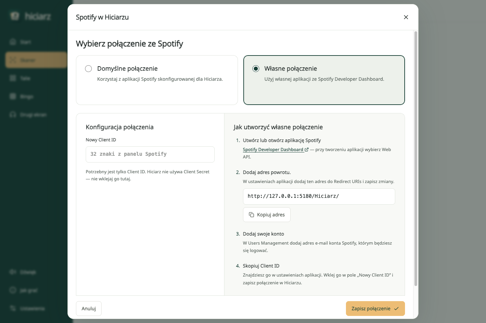
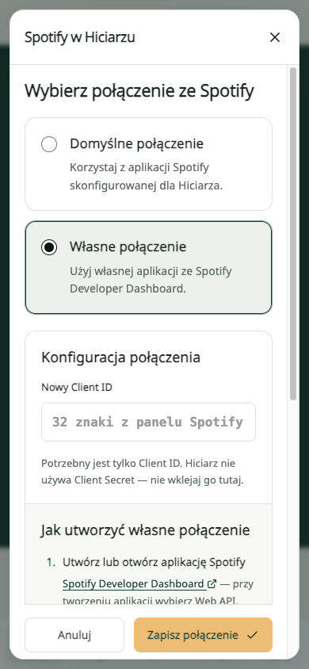

# Spotify w Hiciarzu

[← README](../README.md) · [Otwórz aplikację](https://artifexet.github.io/Hiciarz/) · [Konfiguracja techniczna](configuration.md)

## Wybierz, do czego używasz Spotify

| Funkcja                    | Gdzie ją znajdziesz                                        | Wymagania                                                                                                               |
| -------------------------- | ---------------------------------------------------------- | ----------------------------------------------------------------------------------------------------------------------- |
| Odsłuch na tym urządzeniu  | **Dźwięk → Na tym urządzeniu**, preferowane źródło Spotify | Osadzony odtwarzacz Spotify. Bez Client ID w Hiciarzu; Spotify może odtworzyć tylko fragment i wymagać ręcznego startu. |
| Sterowanie Spotify Connect | **Dźwięk → Spotify Connect**                               | Połączenie Spotify, Premium oraz urządzenie dostępne na zalogowanym koncie.                                             |
| Import playlisty do talii  | **Talie → Utwory → Import i pomoc AI → Ze Spotify**        | Połączenie Spotify i playlista, której jesteś właścicielem lub współtwórcą.                                             |

Import pobiera dane nagrań, a nie pliki audio. Nie jest potrzebny do odtwarzania kart z gotowych przykładów. Kreator, import JSON/CSV i eksport PDF są dostępne bez logowania do Spotify.

Lokalny odtwarzacz korzysta z [Spotify Embed](https://developer.spotify.com/documentation/embeds/references/iframe-api), a sterowanie urządzeniem i import z Web API. Połączenie konta w Hiciarzu nie zmienia ograniczeń odtwarzacza osadzonego. Ramka może pokazać tytuł i okładkę, dlatego przy zgadywaniu warto użyć Connect albo drugiego ekranu ustawionego poza wzrokiem graczy.

## Domyślne czy własne połączenie?

Client ID identyfikuje aplikację Spotify, przez którą logujesz konto. **Jest publiczny.** Hiciarz korzysta z [Authorization Code with PKCE](https://developer.spotify.com/documentation/web-api/tutorials/code-pkce-flow): logowanie odbywa się na stronie Spotify, bez przekazywania hasła do Hiciarza i bez Client Secret.

- **Domyślne połączenie** jest dostępne, jeśli prowadzący publikację skonfigurował Client ID. W trybie deweloperskim Twoje konto musi być dopisane do integracji w Spotify Dashboard.
- **Własne połączenie** przygotowujesz w panelu Spotify, a Client ID wpisujesz w Hiciarzu. Możesz korzystać z tej samej publikacji; nie trzeba robić forka ani budować aplikacji.

Ustawienia otworzysz przez **Ustawienia → Ustawienia Spotify** lub menu konta Spotify. Na telefonie najpierw wybierz **Więcej → Ustawienia**. Pokazują rodzaj połączenia, bez wyświetlania zapisanego Client ID. **Zmień połączenie** otwiera wybór **Domyślne połączenie / Własne połączenie**; opcja domyślna jest dostępna, jeśli skonfigurowano ją dla tej publikacji. Przy własnym połączeniu zobaczysz puste pole **Nowy Client ID** i instrukcję konfiguracji.

Przed logowaniem bez własnego Client ID pojawia się informacja: używasz domyślnego połączenia, a logowanie może nie zadziałać, jeśli Twoje konto nie zostało do niego dodane. Możesz poprosić opiekuna integracji o dostęp albo wybrać **Zmień połączenie** i skonfigurować własne.

  

## Aktualne zasady dostępu Spotify

Stan dokumentacji sprawdzony **11 listopada 2026**:

- Integracje w **Development Mode** wymagają Premium u właściciela aplikacji Spotify. Nowa aplikacja dopuszcza do **5 użytkowników**, dopisanych w **User Management**. Poprawne logowanie bez wpisu na liście może zakończyć się błędem **403** przy wywołaniu API. [Tryby dostępu i limity](https://developer.spotify.com/documentation/web-api/concepts/quota-modes).
- Od lipca 2026 można tworzyć do **25 aplikacji / Client IDs na konto dewelopera**; wcześniejszy limit jednego Client ID jest nieaktualny. Limity zapytań aplikacji deweloperskich są współdzielone na poziomie konta. [Zmiany z lipca 2026](https://developer.spotify.com/documentation/web-api/references/changes/july-2026).
- Starsze integracje mogą zachować istniejące Client IDs i użytkowników ponad nowe limity. Spotify odroczyło część zmian endpointów dla istniejących integracji; ich dostęp może różnić się od nowych aplikacji. [Aktualizacja komunikatu Spotify](https://developer.spotify.com/blog/2026-02-06-update-on-developer-access-and-platform-security), [przewodnik migracji](https://developer.spotify.com/documentation/web-api/tutorials/february-2026-migration-guide).

Własny Client ID nie znosi ograniczeń Spotify. Publiczny dostęp dla szerszej grupy wymaga odpowiedniego trybu przyznanego przez Spotify.

## Przygotuj własny Client ID

1. Otwórz [Spotify Developer Dashboard](https://developer.spotify.com/dashboard). Utwórz aplikację lub wybierz istniejącą. Hiciarz korzysta z **Web API**.
2. W Hiciarzu otwórz **Ustawienia → Ustawienia Spotify → Zmień połączenie → Własne połączenie**. Przy pierwszej konfiguracji wybór połączenia otwiera się od razu. W instrukcji **Jak utworzyć własne połączenie** skopiuj pokazany **adres powrotu**.
3. Dodaj ten adres do **Redirect URIs** w ustawieniach aplikacji Spotify i zapisz zmiany. Dla głównej publikacji jest to `https://artifexet.github.io/Hiciarz/`; dla własnego hostingu skopiuj adres z tej konkretnej strony.
4. W **User Management** dopisz konta, które będą korzystać z integracji, w ramach dostępnego limitu.
5. Skopiuj **Client ID** z panelu Spotify do pola **Nowy Client ID** w Hiciarzu. Wybierz **Zapisz połączenie**, a następnie zaloguj się do Spotify z funkcji importu lub Connect. **Client Secret pozostaje w panelu Spotify — nie wklejaj go do aplikacji.**

Redirect URI musi odpowiadać adresowi używanemu przy logowaniu, łącznie ze ścieżką, wielkością liter i końcowym ukośnikiem. Używaj HTTPS. Lokalnie dozwolony jest adres pętli zwrotnej, np. `http://127.0.0.1:5173/Hiciarz/`; `localhost` nie jest akceptowany przez Spotify. Jeśli Vite wybrał inny port, skopiuj aktualny adres z Hiciarza. [Zasady Redirect URI](https://developer.spotify.com/documentation/web-api/concepts/redirect_uri).

Własny Client ID jest zapamiętywany w tej przeglądarce i ma pierwszeństwo przed domyślnym. Nie jest ponownie wyświetlany w ustawieniach ani wypełniany w formularzu zmiany. Jeśli masz już własne połączenie, pozostawienie pustego pola zachowuje jego konfigurację. Zapisanie innego identyfikatora lub powrót do domyślnego połączenia wylogowuje poprzednią sesję i usuwa wybór urządzenia. Talie pozostają zapisane. Token logowania jest przechowywany w `sessionStorage`; po zakończeniu sesji może być potrzebne ponowne logowanie.

## Odtwarzanie przez Spotify Connect

1. Otwórz Spotify na telefonie, komputerze lub głośniku, na którym ma grać muzyka. Użyj tego samego konta co w Hiciarzu i uruchom na chwilę dowolny utwór.
2. W Hiciarzu wybierz **Dźwięk → Spotify Connect**, skonfiguruj połączenie, jeśli jest potrzebne, i zaloguj konto.
3. Wybierz urządzenie z listy. Jeśli go nie ma, użyj odświeżania urządzeń.
4. Wróć do **Skanera** i zeskanuj kartę ze źródłem Spotify. Hiciarz wyśle polecenie odtwarzania do wybranego urządzenia.

Spotify Premium jest wymagane dla konta, którym sterujesz odtwarzaniem przez API. Muzyka płynie przez Spotify; Hiciarz nie przesyła jej między telefonem a głośnikiem. [Start/Resume Playback](https://developer.spotify.com/documentation/web-api/reference/start-a-users-playback).

Nie każdy model urządzenia obsługuje sterowanie przez API. Hiciarz pomija urządzenia oznaczone przez Spotify jako niedostępne do sterowania. [Dostępne urządzenia Spotify](https://developer.spotify.com/documentation/web-api/reference/get-a-users-available-devices).

## Import playlisty do talii

1. W kreatorze wybierz **Talie → Utwory → Import i pomoc AI → Ze Spotify** i połącz konto.
2. Wklej link do playlisty, której jesteś właścicielem lub współtwórcą.
3. Wybierz dopisanie nagrań na końcu albo zastąpienie listy. Dopisanie zachowuje wcześniejsze poprawki i pomija duplikaty rozpoznane po źródle.
4. Przejrzyj tytuły, wykonawców i lata przed wydrukiem. Rok z albumu może dotyczyć reedycji lub składanki; import oznacza go do sprawdzenia. Dla wariantu filmu lub gry uzupełnij odpowiedzi ręcznie.

Hiciarz korzysta z `GET /playlists/{id}/items`, dostępnego dla playlist własnych lub współtworzonych. Samo obserwowanie cudzej publicznej playlisty lub zapisanie jej w Bibliotece nie daje dostępu do jej utworów. [Dokumentacja Get Playlist Items](https://developer.spotify.com/documentation/web-api/reference/get-playlists-items).

Import ma limit **2000 utworów**. Podcasty, lokalne pliki i pozycje bez prawidłowego źródła nagrania mogą zostać pominięte. Gotowe przykłady w Hiciarzu są zapisanymi projektami JSON i można je wczytać bez importu API.

## Korzystanie na kolejnym urządzeniu

Na telefonie otwórz **Więcej → Ustawienia → Ustawienia Spotify** i wybierz połączenie. Jeśli chcesz użyć własnej aplikacji Spotify, skopiuj Client ID z jej panelu do pola **Nowy Client ID**. Zarejestruj adres powrotu publikacji, z której korzystasz.

Przeglądarka i zainstalowana PWA mogą mieć osobny magazyn danych. Na każdym urządzeniu konfigurujesz połączenie i logujesz się osobno. Client ID nie trafia do QR muzycznych kart ani eksportowanych talii.

## Gdy coś nie działa

| Objaw                                                              | Co sprawdzić                                                                                                                                                                                                          |
| ------------------------------------------------------------------ | --------------------------------------------------------------------------------------------------------------------------------------------------------------------------------------------------------------------- |
| `INVALID_CLIENT` lub błąd Redirect URI                             | Skopiuj adres powrotu z aktualnej publikacji Hiciarza i dodaj go w Dashboard. Sprawdź ścieżkę, wielkość liter, ukośnik i port lokalnego serwera.                                                                      |
| Logowanie się udaje, ale urządzenia lub playlisty zwracają **403** | Sprawdź rodzaj połączenia, konto na liście **User Management** oraz Premium właściciela integracji. Przy domyślnym połączeniu poproś opiekuna o dostęp lub użyj **Zmień połączenie**. Przy odmowie sterowania sprawdź też Premium zalogowanego konta. |
| Cudza playlista jest publiczna, ale import nie działa              | Użyj playlisty własnej lub współtworzonej. Obserwowanie playlisty nie zmienia dostępu do jej zawartości. Możesz też wczytać gotową talię lub JSON/CSV.                                                                |
| Lista urządzeń jest pusta albo urządzenie wygasło                  | Otwórz Spotify na urządzeniu, uruchom utwór i odśwież listę w Hiciarzu. Sprawdź zgodność kont i dostępność modelu przez API.                                                                                          |
| **401**, wygasła sesja lub zmieniony Client ID                     | Zaloguj Spotify ponownie. Po zmianie Client ID ponownie wybierz urządzenie.                                                                                                                                           |
| **429** lub komunikat o limicie                                    | Odczekaj przed ponowieniem. Spotify stosuje limity szybkości i limity współdzielone przez aplikacje jednego konta dewelopera. [Limity API](https://developer.spotify.com/documentation/web-api/concepts/quota-modes). |
| Odtwarzany jest tylko fragment albo brak automatycznego startu     | To może być ograniczenie osadzonego Spotify. Kliknij odtwarzanie lub wybierz Spotify Connect z kontem Premium.                                                                                                        |
| Brak dźwięku z jednej karty                                        | Sprawdź obecność źródła Spotify i dostępność konkretnego nagrania na koncie oraz w regionie. Jeśli karta ma YouTube, możesz wybrać to źródło w odtwarzaniu lokalnym.                                                  |

## Własna publikacja i fork

Możesz opublikować Hiciarza bez domyślnego Client ID — użytkownik wpisze własny w ustawieniach. Możesz też dołączyć domyślny identyfikator jako sekret repozytorium Actions **`SPOTIFY_CLIENT_ID`**. Jest on publiczny w gotowym frontendzie. Wartość zapisana przez użytkownika ma pierwszeństwo.

Zmienna Actions **`SPOTIFY_ONBOARDING`** steruje automatycznym przewodnikiem: `true` pokazuje go przed pierwszym logowaniem dla Client ID, `false` pomija. Bez jawnej wartości główne repozytorium włącza przewodnik, a forki wyłączają. Zmiana połączenia i instrukcja pozostają dostępne w obu wariantach. Informacja o ograniczeniach domyślnego połączenia pojawia się przed logowaniem niezależnie od przełącznika. Brak Client ID zawsze wymaga konfiguracji. [Przełącznik w README](../README.md#przełącznik-przewodnika-dla-własnej-publikacji).

Fork nie kopiuje sekretów GitHub ani Redirect URIs z panelu Spotify. Dodaj adres nowej publikacji w Dashboard i po zmianie sekretu lub zmiennej uruchom workflow ponownie. Lokalnie odpowiadają im `VITE_SPOTIFY_CLIENT_ID` i `VITE_SPOTIFY_ONBOARDING`; [przykład zmiennych](../.env.example).
