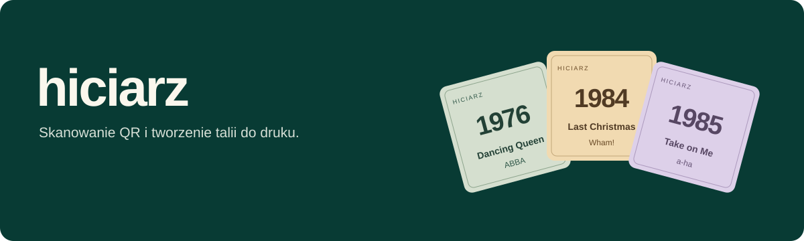
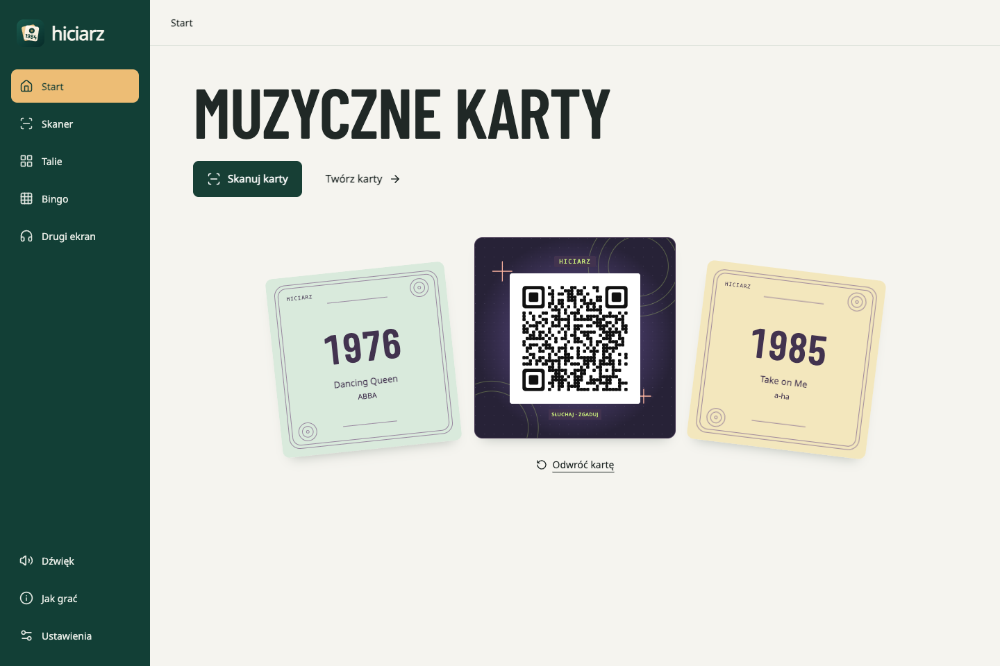
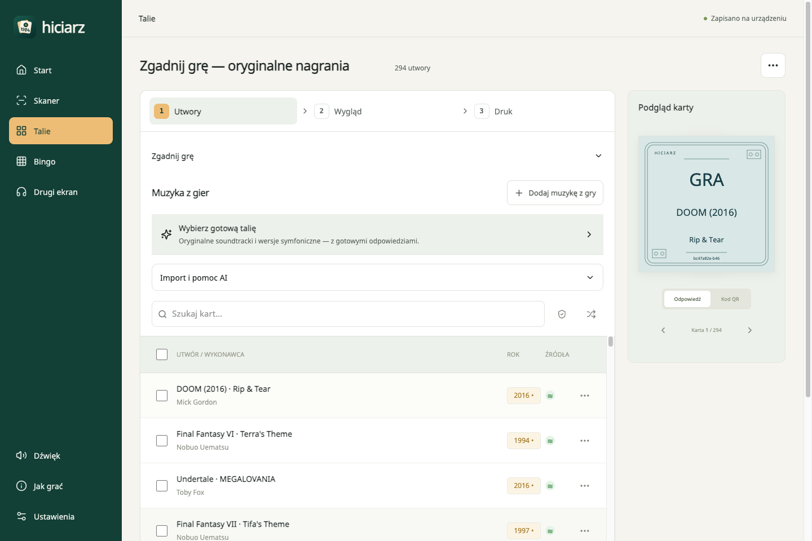
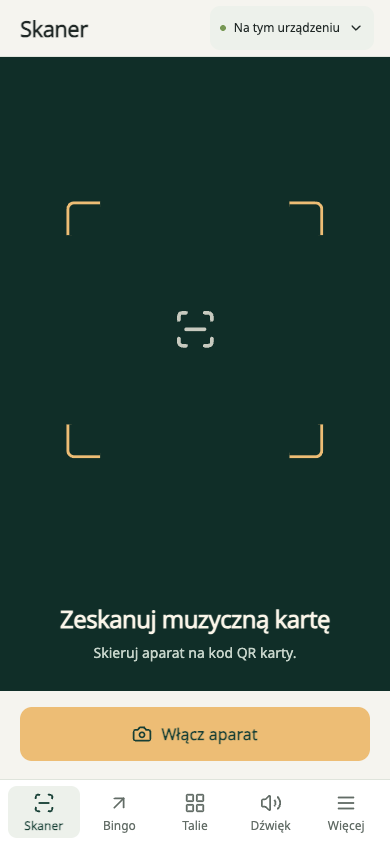
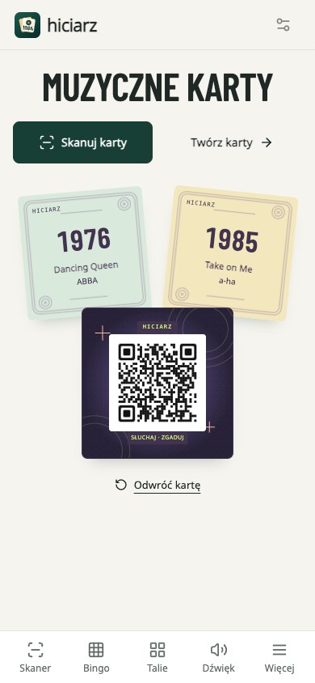

<p align="center">
  
</p>

<p align="center">
  Twórz własne karty muzyczne, skanuj je telefonem i słuchaj ulubionych nagrań.
</p>

<p align="center">
  <a href="https://artifexet.github.io/Hiciarz/"></a>
  <a href="#pierwsze-kroki"></a>
  <a href="https://buymeacoffee.com/szymonrybka"></a>
</p>

<p align="center">
  <a href="https://github.com/ArtifexEt/Hiciarz/actions/workflows/pages.yml"></a>
  &nbsp; Przeglądarka · Telefon · PWA · Własne talie · PDF do druku
</p>

Hiciarz łączy kreator kart, skaner QR i odtwarzacz. Przygotuj listę nagrań, wybierz wygląd i wydrukuj talię. Zeskanuj kod QR, aby posłuchać utworu; na drugiej stronie karty znajdziesz jego dane. Muzyczne [Bingo z planszami do druku](https://artifexet.github.io/Bingo/) jest osobną aplikacją w [repozytorium ArtifexEt/Bingo](https://github.com/ArtifexEt/Bingo).

**[Spotify: dodawanie utworów i odsłuch](docs/spotify.md)** · **[Format playlist JSON/CSV](docs/playlist-guide.md)** · **[Uruchomienie i publikacja](docs/configuration.md)**

## Zobacz aplikację

Ekran startowy na komputerze:



<table>
  <tr>
    <th>Tworzenie talii</th>
    <th>Odtwarzanie na komputerze</th>
  </tr>
  <tr>
    <td width="50%" align="center"><a href="docs/screenshots/editor-desktop.png"></a></td>
    <td width="50%" align="center">W panelu <strong>Dźwięk</strong> wybierz <strong>Na tym urządzeniu</strong> lub <strong>Drugi ekran</strong>.</td>
  </tr>
</table>

<table>
  <tr>
    <th>Skaner na telefonie</th>
    <th>Osobna aplikacja Bingo</th>
  </tr>
  <tr>
    <td width="50%" align="center"><a href="docs/screenshots/scanner-mobile.png"></a></td>
    <td width="50%" align="center"><a href="https://artifexet.github.io/Bingo/">Otwórz Bingo</a><br>Losowanie kategorii, zasady i generator plansz PDF.</td>
  </tr>
  <tr>
    <th>Gdzie ma grać muzyka?</th>
    <th>Start na telefonie</th>
  </tr>
  <tr>
    <td width="50%" align="center">W panelu <strong>Dźwięk</strong> wybierz <strong>Na tym urządzeniu</strong> lub <strong>Drugi ekran</strong>.</td>
    <td width="50%" align="center"><a href="docs/screenshots/home-mobile.png"></a></td>
  </tr>
</table>

## Pierwsze kroki

1. **[Otwórz Hiciarza](https://artifexet.github.io/Hiciarz/)** i wybierz **Twórz karty**. Jeśli masz już wydrukowaną talię, przejdź do **Skanuj karty**.
2. **Przygotuj talię.** W widoku **Talie → Utwory** wybierz **Rodzaj kart**, a następnie **Importuj**. Kreator pozwala wczytać plik JSON/CSV, wybrać gotową talię albo przygotować listę z AI. W kroku **Przygotuj talię z AI** skopiuj prompt do swojego asystenta, a później wczytaj gotowy plik. Nagrania możesz też dodawać ręcznie: w **Dodaj utwór** wklej link Spotify, sprawdź odsłuch i wyszukaj rok w MusicBrainz. Sprawdź linki i lata przed drukiem.
3. **Wydrukuj karty.** Przejdź przez **Utwory → Wygląd → Druk** i wybierz **Pobierz / drukuj karty**. PDF mieści 12 kart 60 × 60 mm na A4. Drukuj dwustronnie w skali 100%, zgodnie z krawędzią obrotu pokazaną w oknie wydruku. Przed całą talią wykonaj próbę z **Próba wydruku i kalibracja**.
4. **Wybierz miejsce odtwarzania.** Otwórz **Dźwięk** i wybierz jeden z wariantów opisanych poniżej.
5. **Skanuj i słuchaj.** Zezwól na aparat, zeskanuj QR z karty i posłuchaj nagrania. Po odwróceniu wydrukowanej karty znajdziesz jej dane. Jeśli przeglądarka zablokuje automatyczny start, użyj przycisku odtwarzania.

## Gdzie ma grać muzyka?

| Wybór w **Dźwięk**    | Jak działa                                                                     | Co przygotować                                                                                                                                                     |
| --------------------- | ------------------------------------------------------------------------------ | ------------------------------------------------------------------------------------------------------------------------------------------------------------------ |
| **Na tym urządzeniu** | Spotify lub YouTube odtwarza w skanerze na telefonie albo tablecie.            | Bez parowania i bez łączenia konta. Nagranie musi pozwalać na osadzanie; Spotify może udostępnić tylko fragment.                                                   |
| **Drugi ekran**       | Telefon skanuje karty, a połączony komputer lub drugi telefon odtwarza muzykę. | Na drugim urządzeniu otwórz **Drugi ekran** i wybierz **Połącz skaner**. W skanerze zeskanuj QR parowania, a następnie karty. Oba urządzenia potrzebują internetu. |

Osadzony odtwarzacz może pokazywać tytuł i okładkę. Drugi ekran pozwala oddzielić skanowanie kart od odtwarzania muzyki.

Po skanie możesz zatrzymać lub wznowić utwór, przełączyć źródło dostępne na karcie i wybrać **Skanuj kolejną kartę**. Powrót do aparatu zatrzymuje lokalny odtwarzacz. Internet i dostępność nagrania w danym regionie są wymagane niezależnie od zapisania aplikacji jako PWA.

## Spotify bez łączenia konta

Dodawanie kart i odtwarzanie nie wymagają logowania do Spotify w Hiciarzu ani konfiguracji aplikacji deweloperskiej.

1. Wybierz **Talie → Utwory → Dodaj utwór** i wklej link do konkretnego nagrania Spotify.
2. Posłuchaj podglądu w pierwszym kroku i wybierz **Dalej: dane utworu**. W drugim kroku sprawdź pobrany tytuł i wpisz wykonawcę. **Wstecz** pozwala wrócić do linku bez utraty ręcznych poprawek.
3. Wyszukaj rok w MusicBrainz i wybierz właściwą wersję nagrania. Rok oraz dane możesz poprawić ręcznie.
4. Zatwierdź kartę po sprawdzeniu danych.

Podgląd Spotify może być niedostępny lub ograniczony do fragmentu. MusicBrainz dostarcza metadane, a nie audio; data dotyczy konkretnej wersji nagrania i może wymagać korekty. Brak odpowiedzi serwisu nie blokuje ręcznego dodania karty.

Całe playlisty wczytasz z pliku JSON/CSV zgodnego z formatem Hiciarza. Link do playlisty nie zastępuje listy jej utworów. [Dodawanie i odsłuch](docs/spotify.md) · [Format plików](docs/playlist-guide.md).

## Talie, wygląd i rodzaje kart

- **Utwory muzyczne:** karty z tytułem, wykonawcą i rokiem wydania nagrania.
- **Muzyka z filmów / Muzyka z gier:** wybierz kategorię przez **Rodzaj kart → Inne rodzaje kart** i uzupełnij tytuł produkcji. Podgląd dostarcza dane nagrania; tytuł filmu lub gry wpisujesz samodzielnie. Jest drukowany na stronie **Dane karty** i nie trafia do QR.
- **Muzyczne Bingo:** [osobna aplikacja](https://artifexet.github.io/Bingo/) z losowaniem kategorii, poziomami trudności oraz planszami 5 × 5. Przygotujesz od 1 do 24 plansz, po 1, 2 lub 4 na stronie A4.
- **Wygląd kart:** dziewięć motywów, własne rewersy z obsługą przeciągania plików, presety i oszczędny wydruk **Laser — lekki kolor**. Podgląd karty odzwierciedla układ PDF. Karty z własnym motywem zachowują go przy zmianie motywu talii; ujednolica je przycisk **Zastosuj motyw talii do wszystkich kart**. Skórka strony jest wybierana osobno w ustawieniach; nie zmienia motywu zapisanej talii.

[Generator plansz Bingo — podstawowy PL](https://artifexet.github.io/Bingo/?sheet=print&level=beginner&lang=pl) · [Zaawansowany PL](https://artifexet.github.io/Bingo/?sheet=print&level=expert&lang=pl) · [Beginner EN](https://artifexet.github.io/Bingo/?sheet=print&level=beginner&lang=en). Generator, losowanie i zasady są utrzymywane w [osobnym repozytorium](https://github.com/ArtifexEt/Bingo). Dawne adresy Hiciarza z `?view=bingo` przekierowują do nowej aplikacji, zachowując prawidłowe parametry poziomu, języka i okna druku.

**Talie → Utwory → Importuj → Wybierz gotową talię** udostępnia przykłady bez logowania:

| Przykład                            | Zawartość                                |
| ----------------------------------- | ---------------------------------------- |
| Świąteczne hity                     | 151 piosenek z motywem Rybki świąteczne. |
| Muzyka z gier — oryginalne nagrania | 294 karty z 93 gier.                     |
| Muzyka z gier — symfonicznie        | 34 orkiestrowe aranżacje z 34 gier.      |

Przykład można otworzyć jako nową talię lub dopisać do obecnej. To edytowalna kopia zapisanych danych, która nie aktualizuje się automatycznie. Lata z wydań Spotify mogą oznaczać składanki lub reedycje — sprawdź je przed drukiem. [Pliki i źródła przykładów](examples/playlists/README.md).

Import JSON/CSV pyta o dopisanie na końcu albo zastąpienie listy. Dopisywanie zachowuje poprawki i pomija duplikaty rozpoznane po źródle nagrania. JSON i CSV obsługują `gameMode` (`music`, `movie`, `game`) oraz `answer` wymagane dla filmu i gry. [Format plików i prompt dla AI](docs/playlist-guide.md).

## Telefon, PWA i zapis danych

Na telefonie dolny pasek zawiera **Skaner**, **Bingo** (link do osobnej aplikacji), **Talie**, **Dźwięk** i **Więcej**. Na komputerze widoki są w bocznym pasku. Logo wraca do startu, a **Wstecz** zamyka okno lub wraca do poprzedniego widoku. Link **Bingo** otwiera osobną aplikację prowadzącego i generator plansz.

Skaner wypełnia ekran telefonu, z głównymi przyciskami nad dolnym menu. Miejsce odtwarzania zmienisz też w jego górnym pasku. W układzie poziomym aparat jest obok kontrolek. Do startu wrócisz przez **Więcej → Start**.

W **Ustawieniach** zmienisz skórkę strony i język (**polski / angielski**), sprawdzisz aktualizacje i zainstalujesz Hiciarza. Na iOS aplikacja pokazuje instrukcję dodania do ekranu początkowego przez menu udostępniania. Zmiana języka obejmuje interfejs oraz napisy na PDF; dane wpisane do talii pozostają bez zmian. [Słowniki JSON](docs/configuration.md#tłumaczenia-json).

Talie i grafiki są zapisywane **na tym urządzeniu**. W **Talie** przełączysz projekty, utworzysz nowy lub pobierzesz pełną kopię JSON przez **Zapisz do pliku**. Plik wczytasz przez **Utwory → Importuj → Wczytaj z pliku**. Listę utworów wyeksportujesz również jako CSV. Zapis do pliku pozwala przenieść projekt i chroni przed utratą danych po wyczyszczeniu przeglądarki.

Po zapisaniu zasobów PWA można bez sieci edytować talie i przygotowywać PDF. Muzyka, Spotify i parowanie wymagają internetu. Aparat na telefonie wymaga bezpiecznego kontekstu — korzystaj z publikacji HTTPS. [Dane lokalne i PWA](docs/configuration.md#dane-lokalne-i-pwa).

## Uruchomienie i rozwój

Wymagane: **Node.js 22+** i **pnpm 11**.

```sh
# Z głównego katalogu repozytorium:
cd web
pnpm install
pnpm dev
```

Otwórz adres wypisany przez Vite z końcówką `/Hiciarz/`, zwykle `http://127.0.0.1:5173/Hiciarz/`.

```sh
pnpm test
pnpm build
pnpm preview
```

Do podglądu Spotify i pobierania metadanych z MusicBrainz nie są potrzebne klucze API ani zmienne Spotify. Opcjonalne ustawienia własnego serwera parowania znajdziesz w [.env.example](.env.example).

GitHub Actions uruchamia testy i budowanie. Workflow **Publish website** publikuje GitHub Pages automatycznie po zmianach w `web/` lub samym workflow na `main`; można go też uruchomić ręcznie. Zmiany wyłącznie w aplikacji Android nie wdrażają strony. Fork używa nazwy swojego repozytorium jako ścieżki bazowej. [Pełna konfiguracja publikacji](docs/configuration.md).

## Dokumentacja

| Dokument                                              | Zawartość                                                          |
| ----------------------------------------------------- | ------------------------------------------------------------------ |
| [Spotify](docs/spotify.md)                            | Link do utworu, odsłuch, rok z MusicBrainz i pomoc przy błędach.   |
| [Konfiguracja techniczna](docs/configuration.md)      | Publikacja, zmienne Actions, parowanie, PWA, tłumaczenia i zasoby. |
| [Przygotowanie listy utworów](docs/playlist-guide.md) | JSON/CSV i przygotowanie playlisty z pomocą AI.                    |
| [Gotowy prompt](docs/playlist-prompt.txt)             | Instrukcja do skopiowania do wybranego AI.                         |
| [Przykładowe playlisty](examples/playlists/README.md) | Gotowe pliki, źródła nagrań i dodawanie kolejnych zestawów.        |

Linki do dokumentacji znajdziesz też w aplikacji: **Jak korzystać** (na telefonie **Więcej → Jak korzystać**). Przewodnik opisuje dodawanie kart bez łączenia konta Spotify.

[Zgłoś usterkę](https://github.com/ArtifexEt/Hiciarz/issues/new) lub przejrzyj pomysły w [Issues](https://github.com/ArtifexEt/Hiciarz/issues). Jeśli Hiciarz uprzyjemnił Wam wieczór, możesz [postawić autorowi kawę](https://buymeacoffee.com/szymonrybka).
